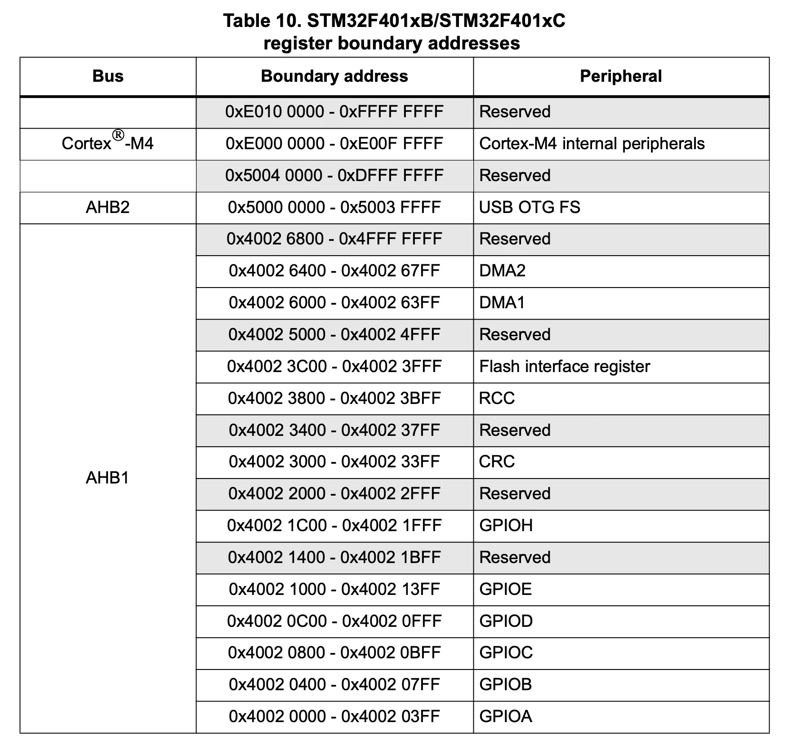

+++
date = '2026-10-15T21:13:40+09:00'
# draft = true
title = '01. Memory Mapping'
+++

이 문서는 Micro Controller Unit과 친해지기 위해
STM32F401CCU6를 기반으로 공부하며 알게 된 내용을 정리한 글이다.

공부를 하면서 참고한 문서들은 다음과 같다.

- [STM32F401CC Product Specification](https://www.st.com/resource/en/datasheet/stm32f401cc.pdf)
- [STM32F401CC Reference Manual](https://www.st.com/resource/en/reference_manual/rm0368-stm32f401xbc-and-stm32f401xde-advanced-armbased-32bit-mcus-stmicroelectronics.pdf)
- [STM32F401 Discovery Kit User Manual](https://pack-content.cmsis.io/Keil/STM32F4xx_DFP/2.17.1/MDK/Boards/ST/STM32F401C-Discovery/Documentation/DM00093902.pdf)
- [Arm® Cortex®-M4 Processor Technical Reference Manual](https://documentation-service.arm.com/static/5fce431be167456a35b36ade)

---

## Memory Map

STM32F401의 코어는 Arm® 32-bit Cortex®-M4를 사용한다.
해당 칩의 프로세서는 32bit의 주소를 사용한다고 볼 수 있는데,
이는 4,294,967,296개의 주소를 사용할 수 있음을 뜻하며 대략적으로 4G의 용량을 가진다.

아래는 Product Specification 문서의 5. Memory Mapping에서 발췌한 일부 내용이다.

위 테이블을 보면, `GPIOA`, `GPIOB`, `GPIOC`, ... 등 다양한 장치들이 각기 다른 주소를 할당받고 있는 것을 볼 수 있다.
예를 들어 `GPIOA`는 `0x4002 0000` ~ `0x4002 0400`까지의 주소를 할당받고 있다.
