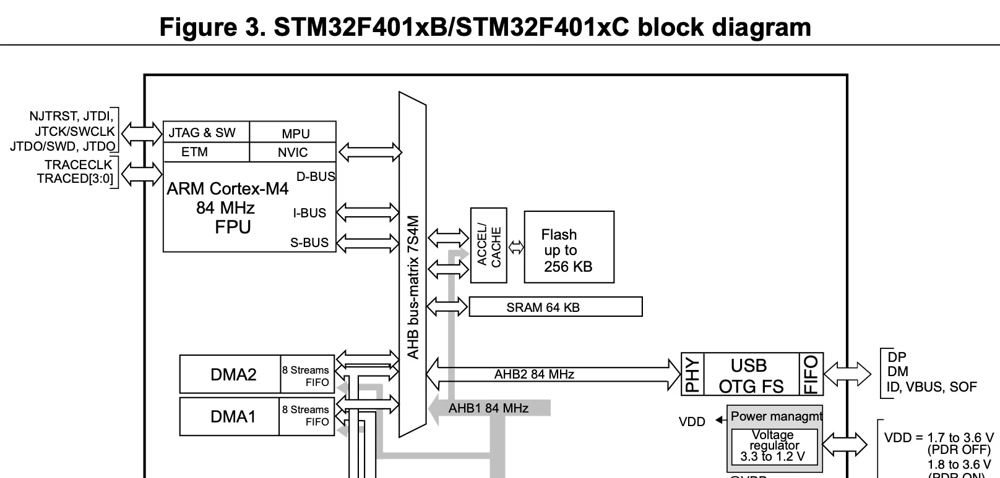
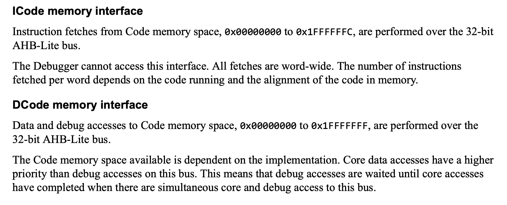
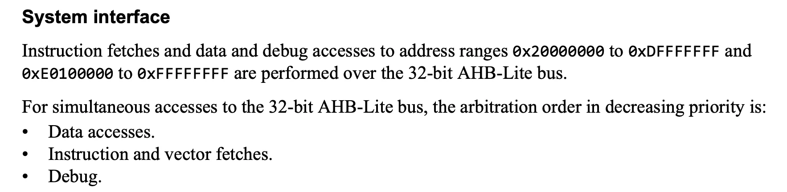
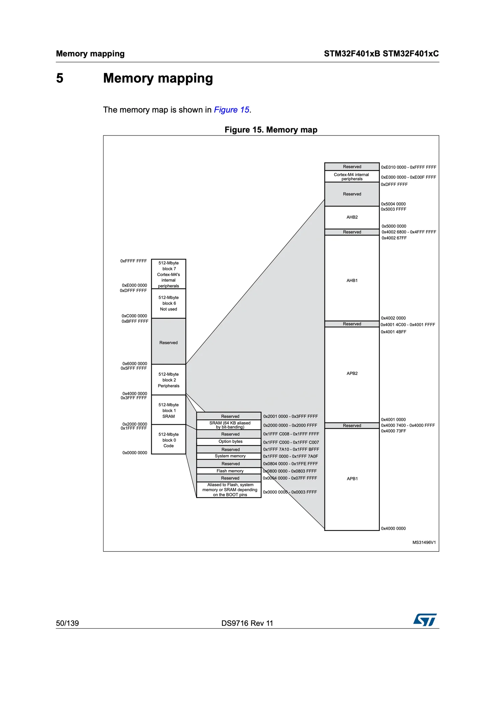
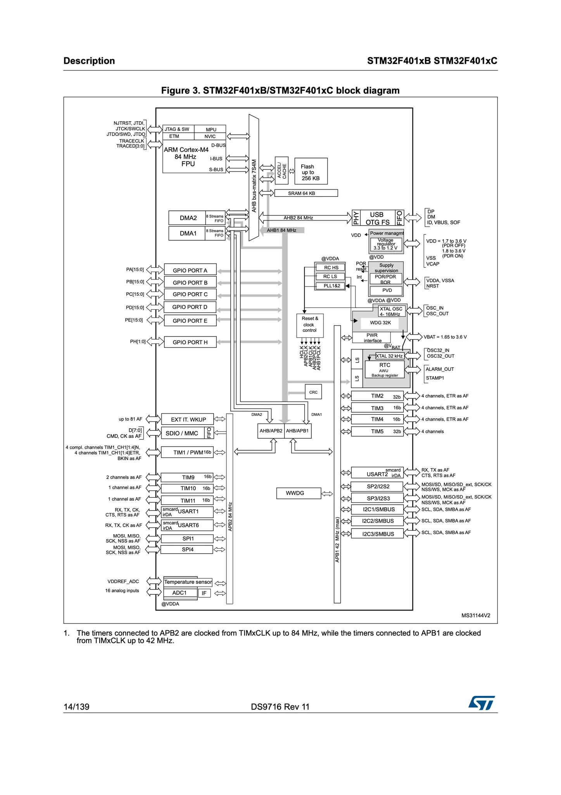
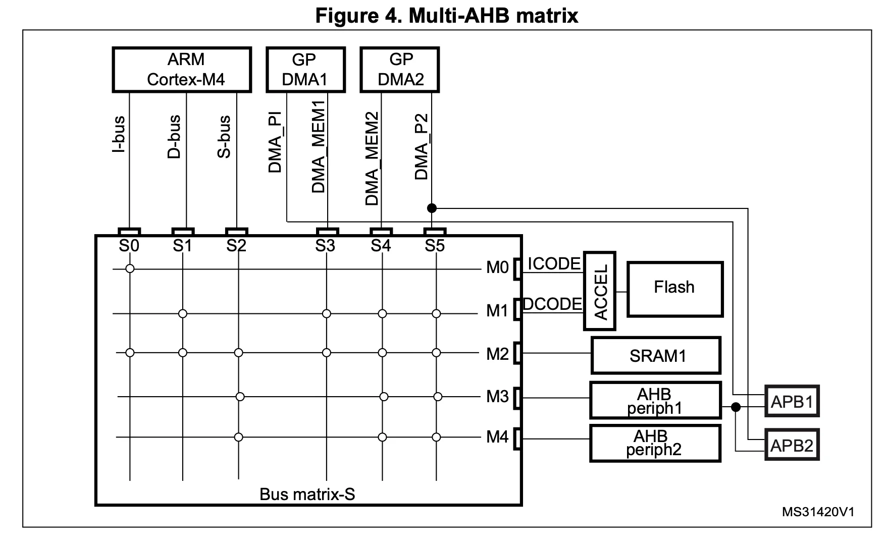

+++
date = '2026-10-15T21:55:58+09:00'
# draft = true
title = '02. Bus Interfaces'
+++

이 문서는 Micro Controller Unit과 친해지기 위해
STM32F401CCU6를 기반으로 공부하며 알게 된 내용을 정리한 글이다.

공부를 하면서 참고한 문서들은 다음과 같다.

- [STM32F401CC Product Specification](https://www.st.com/resource/en/datasheet/stm32f401cc.pdf)
- [STM32F401CC Reference Manual](https://www.st.com/resource/en/reference_manual/rm0368-stm32f401xbc-and-stm32f401xde-advanced-armbased-32bit-mcus-stmicroelectronics.pdf)
- [STM32F401 Discovery Kit User Manual](https://pack-content.cmsis.io/Keil/STM32F4xx_DFP/2.17.1/MDK/Boards/ST/STM32F401C-Discovery/Documentation/DM00093902.pdf)
- [Arm® Cortex®-M4 Processor Technical Reference Manual](https://documentation-service.arm.com/static/5fce431be167456a35b36ade)

---

## Bus Interfaces

STM32F401CCU6은 Arm® 32-bit Cortex®-M4 프로세서를 탑재하고 있으며, 해당 프로세서는 다른 주변 장치들과 버스를 통해 소통한다.



위 다이어그램을 보면, ARM Cortex-M4는 D-BUS, I-BUS, S-BUS를 갖고 있으며, 해당 버스들은 AHB bus-matrix를 통해 Flash, SRAM 등과 연결되어 있다.

Arm® Cortex®-M4 Processor Technical Reference Manual에 따르면 ARM Cortex-M4 프로세서는 3개의 Advanced High-performance Bus(AHB) 인터페이스를 갖고 있으며, 이는 각각 I-Bus, D-Bus, S-Bus를 의미한다.




- Instruction Bus: Instruction Code를 Flash로부터 가져오는 읽기 전용 버스이며, 해당 코드는 `0x0000 0000` ~ `0x1FFF FFFC` 주소 영역에 할당되어 있다.
- Data Bus: Data, Debug 정보를 읽고 쓰는 버스이며, 해당 데이터는 `0x0000 0000` ~ `0x1FFF FFFF` 주소 영역에 할당되어 있다.
- System Bus: Instruction Code를 가져오거나 Data, Debug 정보를 읽고 쓰는 버스이며, 해당 대상은 `0x2000 0000` ~ `0xDFFF FFFF` 또는 `0xE010 0000` ~ `0xFFFF FFFF` 주소 영역에 할당되어 있다.



앞서 살펴본 버스별로 사용하는 주소를 보면, I-Bus, D-Bus는 Flash memory를 사용하고 있지만, S-Bus는 SRAM 및 기타 주변장치와 연결되어 있음을 알 수 있다.

---

아래 C 코드와 설명을 통해 실제 MCU 내부에서는 Flash Memory와 SRAM이 어떻게 연결되는지 확인해보자.

```C
#include <string.h>
#include <stdint.h>
/*
 * [문자열 리터럴 "Hi there, Good Morning !"]
 * 섹션: .rodata (읽기 전용 데이터)
 * 저장 위치: Flash Memory (ROM)
 * 접근 버스: D-Bus를 통해 플래시에서 로드
 *
 * [포인터 변수 pMessage 자체]
 * 섹션: .data (초기화된 전역 변수)
 * 저장 위치: Flash에 초기값(문자열 주소) 저장 -> 부팅 시 SRAM으로 복사되어 SRAM에 상주
 * 접근 버스: S-Bus를 통해 SRAM에서 접근
 */
const char *pMessage = "Hi there, Good Morning !";

/*
 * [상수 변수 value]
 * 섹션: .rodata (읽기 전용 데이터)
 * 저장 위치: Flash Memory (ROM)
 * 접근 버스: D-Bus를 통해 플래시에서 직접 로드 (SRAM 점유 없음)
 */
const int value = 200;

/*
 * [비초기화 전역 배열 myData]
 * 섹션: .bss (초기화되지 않은 전역 데이터)
 * 저장 위치: SRAM (Flash 용량은 차지하지 않으며, 스타트업 시 0으로 채움)
 * 접근 버스: S-Bus를 통해 SRAM에 읽기/쓰기 수행
 */
char myData[50];

/*
 * [main 함수 본체]
 * 섹션: .text (실행 코드)
 * 저장 위치: Flash Memory (ROM)
 * 접근 버스: ICode (I-Bus)를 통해 CPU가 명령어(Instruction)를 페치(Fetch)
 */
int main(void) {

    /*
    * [루프 실행 시 하드웨어 버스 상호작용]
    * 1. ICode (I-Bus) : Flash(.text)로부터 기계어 명령어(LDR, STR 등)를 페치
    * 2. DCode (D-Bus) : Flash(.rodata)에 있는 문자열 *(pMessage + i) 데이터를 읽어옴
    * 3. System Bus (S-Bus) : 읽어온 문자를 SRAM(.bss)의 myData[i] 주소에 기록
    */
    for (uint32_t i = 0; i < strlen(pMessage); i++) {
        myData[i] = *(pMessage + i); /* FLASH(.rodata) -> SRAM(.bss) 데이터 복사 */
    }

    for (;;);
}
```

---

## AHB / APB



Advanced High-performance Bus(AHB)는 Advanced Peripheral Bus(APB)로 분기되며, AHB는 고속으로 동작하는 반면 APB는 저속으로 동작한다.
STM32F401CCU6 칩은 AHB1, AHB2, APB1, APB2로 구성되어 있으며, AHB1은 APB1, APB2로 분기된다.
AHB은 84MHz로 동작하며, APB는 42MHz로 동작한다.

---

## AHB bus-matrix

ARM Cortex-M4 프로세서는 AHB bus-matrix를 통해 주변장치들과 소통한다.



위 사진은 Bus matrix의 역할을 보여주는 사진인데, ARM Cortex-M4의 I-bus/D-bus를 보면 Flash와 SRAM1과 연결되어 있음을 알 수 있다.
반면 S-bus는 Flash를 제외한 SRAM1 및 다른 주변장치와 연결되어 있다.
