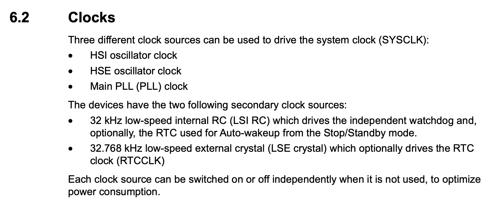
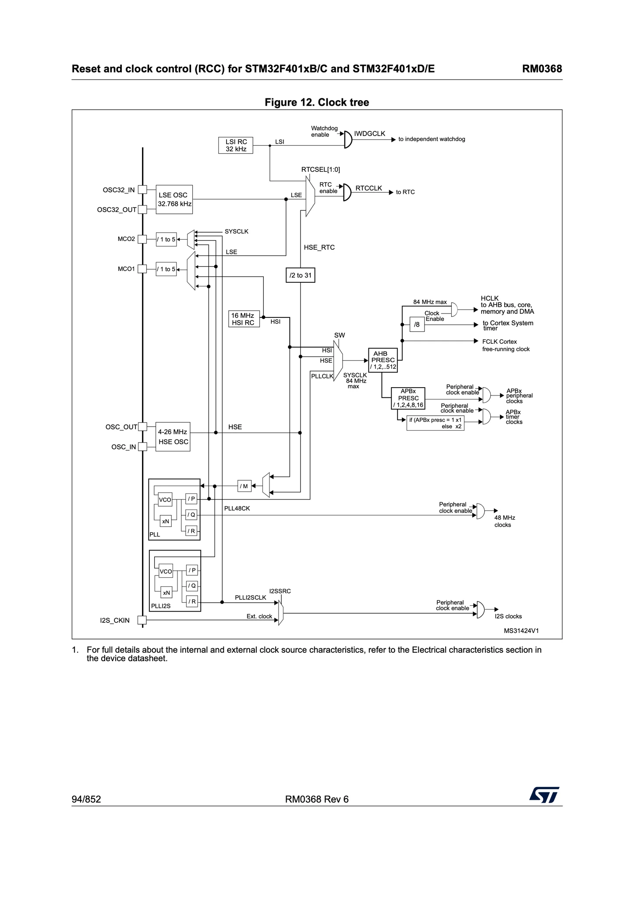
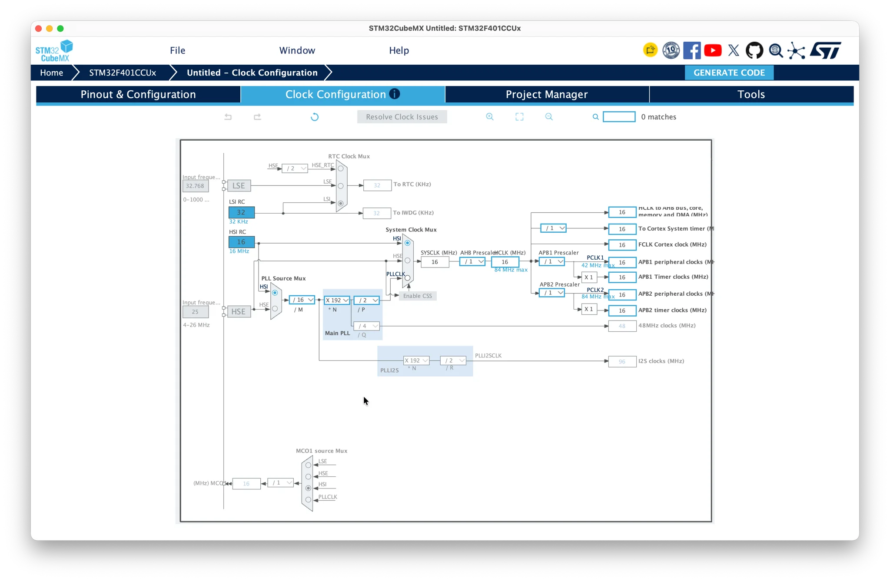
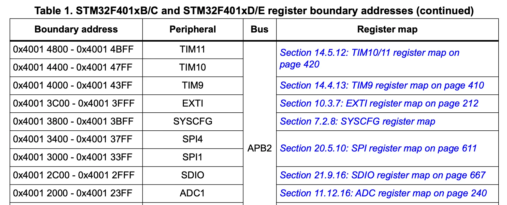
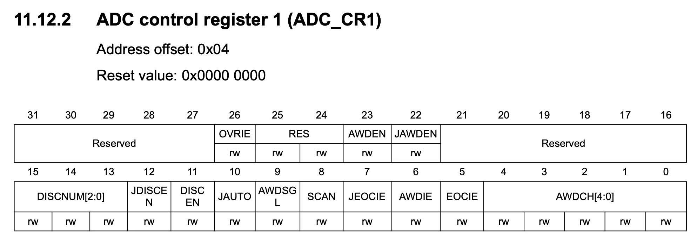
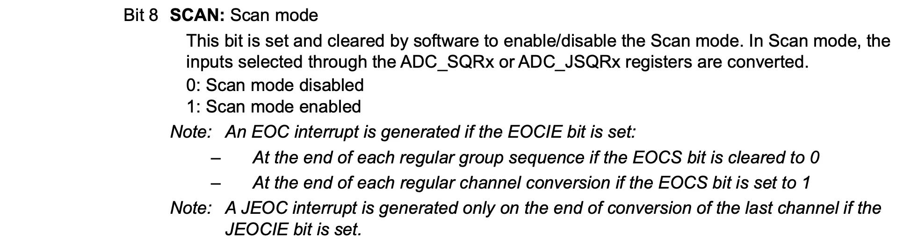
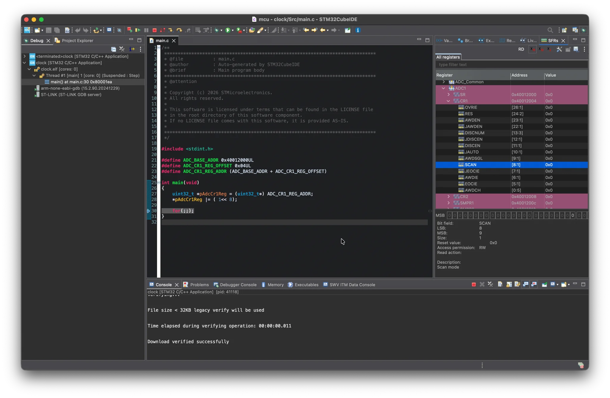
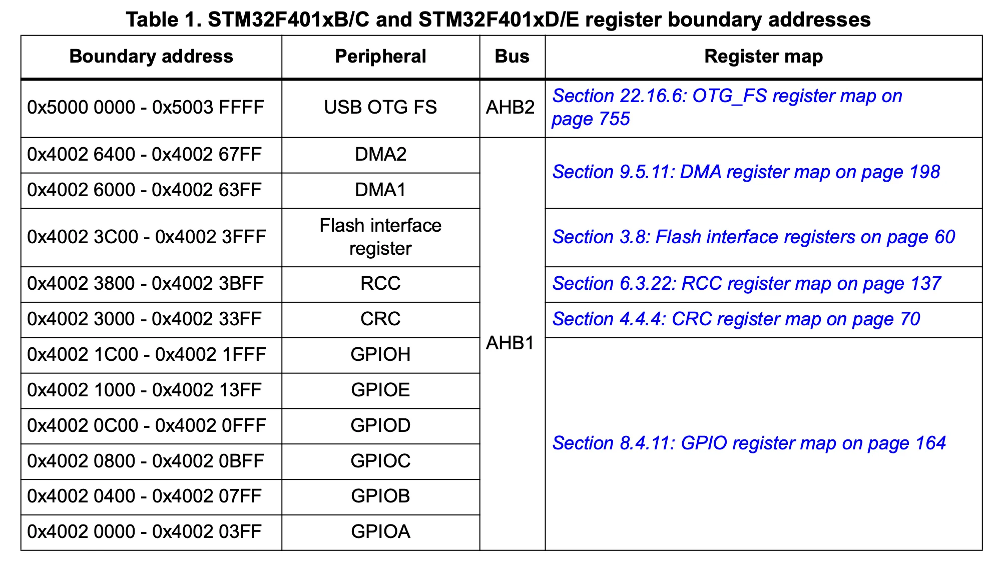
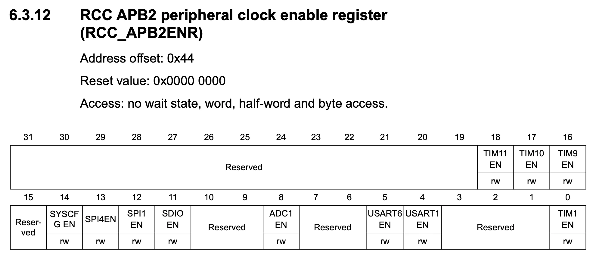
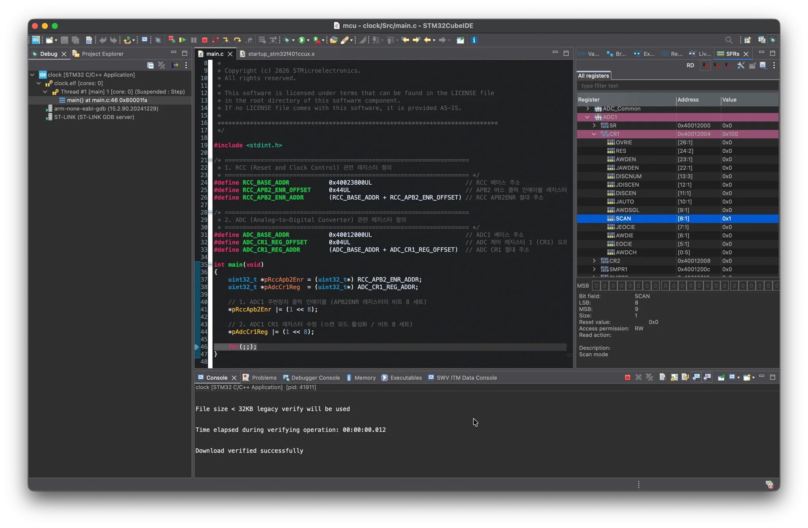

+++
date = '2026-10-17T22:12:20+09:00'
# draft = true
title = '03. Clocks'
+++

이 문서는 Micro Controller Unit과 친해지기 위해
STM32F401CCU6를 기반으로 공부하며 알게 된 내용을 정리한 글이다.

공부를 하면서 참고한 문서들은 다음과 같다.

- [STM32F401CC Product Specification](https://www.st.com/resource/en/datasheet/stm32f401cc.pdf)
- [STM32F401CC Reference Manual](https://www.st.com/resource/en/reference_manual/rm0368-stm32f401xbc-and-stm32f401xde-advanced-armbased-32bit-mcus-stmicroelectronics.pdf)
- [STM32F401 Discovery Kit User Manual](https://pack-content.cmsis.io/Keil/STM32F4xx_DFP/2.17.1/MDK/Boards/ST/STM32F401C-Discovery/Documentation/DM00093902.pdf)
- [Arm® Cortex®-M4 Processor Technical Reference Manual](https://documentation-service.arm.com/static/5fce431be167456a35b36ade)

---

## MCU Clocking System

클럭은 다음과 같은 이유로 MCU에서 정말 중요한 요소 중 하나이다.

1. 내부 로직 및 주변장치 컴포넌트는 클럭 신호에 의해 트리거되므로, 클럭 공급이 없으면 해당 하드웨어 블록들이 정상적으로 동작할 수 없다.
2. 클럭은 각 연산과 프로세스가 언제 실행되어야 하는지를 결정한다. 즉, 디지털 회로가 특정 동작을 수행하기 위한 정확한 타이밍을 보장한다.
3. 클럭 주파수는 전력 소비와도 밀접한 관계가 있는데, 저전력 애플리케이션을 목표로 할 경우 클럭 주파수를 신중하게 선택해야 한다. 클럭 주파수가 높을수록 전력을 더 많이 소모하는 경향이 있기 때문이다.
4. 클럭을 통해 내부 모듈 간의 동작 타이밍을 동기화함으로써, 신호 전달 시점의 불일치로 인한 타이밍 오류를 방지할 수 있다.



MCU는 시스템 클럭을 사용하기 위해 3개의 클럭 소스를 사용한다.

- High-Speed Internal Oscillator (HSI)
- High-Speed External Oscillator (HSE)
- Main Pharse-Locked Loop (PLL)

HSI는 내부 RC 오실레이터 기반 클럭으로, MCU 리셋 시 시스템 클럭(SYSCLK)의 기본 소스로 자동 선택된다. 따라서 리셋 후 HSE나 PLL로 클럭 소스를 전환하려면 소프트웨어 레지스터 설정을 통해 명시적으로 변경해야 한다.

HSE는 외부 크리스털/세라믹 레조네이터 또는 외부 클럭 신호를 입력받아 MCU에 클럭을 공급한다.

PLL은 HSI 또는 HSE를 입력 소스로 받아 주파수를 체배(증폭)함으로써, 시스템 요구사항에 맞는 고주파수 시스템 클럭을 생성·공급할 때 사용한다.



Reference Manual를 통해 각 클럭 소스들의 레지스터 구조를 확인할 수 있다.



하지만, STM32CubeMX를 통해 클럭을 설정하면 위 이미지처럼 클럭 계통도를 UI로 한눈에 확인할 수 있어 편리하다.

---

## Peripheral Clock Configuration

MCU는 전력 소모를 막기 위해 모든 주변장치의 클럭은 비활성화 되어 있다. 따라서 주변 장치를 사용하기 위해선 Peripheral Clock Register를 통해 클럭을 활성화해야만 한다.

STM32 micro controller에서 주변 장치 클럭은 RCC(Reset and Clock Control) Register를 통해 제어한다.

예를 들어 ADC control register 1의 SCAN을 활성화한다고 가정해보자.





Reference Manual를 보면, ADC control register 1(ADC_CR1)를 통해 아래와 같은 사실을 알 수 있다.

- Base Address: 0x4001 2000
- Offset: 0x04
- SCAN: bit 8

그럼 코드를 작성해보고, 결과를 확인해보자.

```C
#include <stdint.h>
/* ====================================================================
 * ADC (Analog-to-Digital Converter) 관련 레지스터 정의
 * ==================================================================== */
#define ADC_BASE_ADDR           0x40012000UL                          // ADC1 베이스 주소
#define ADC_CR1_REG_OFFSET      0x04UL                                // ADC 제어 레지스터 1 (CR1) 오프셋
#define ADC_CR1_REG_ADDR        (ADC_BASE_ADDR + ADC_CR1_REG_OFFSET)  // ADC CR1 절대 주소
int main(void)
{
    uint32_t *pAdcCr1Reg  = (uint32_t*) ADC_CR1_REG_ADDR;
    // ADC1 CR1 레지스터 수정 (스캔 모드 활성화 / 비트 8 세트)
    *pAdcCr1Reg |= (1 << 8);
    for(;;);
}
```



STM32CubeIDE의 디버거로 분석해보면, ADC control register 1의 8번째 비트는 0으로 되어 정상적으로 동작하지 않는 것을 알 수 있다.

이는 우리가 사용할 주변장치를 설정하기 전에 반드시 해당 주변장치와 연결된 버스를 먼저 활성화해야 하기 때문이다. 즉, 버스를 활성화하기 전에는 주변 장치 레지스터에 접근할 수 없다.
그러므로 ADC1과 연결된 버스를 확인하여 해당 버스의 클럭을 활성화해보자.





Reference Manual를 보면 ADC1은 APB2 버스와 연결되어 있다. APB2 버스를 활성화하기 위해선 RCC 레지스터에서 RCC APB2 peripheral clock enable register(RCC_APB2ENR)를 통해 활성화할 수 있다.

- RCC Base Address: 0x4002 3800
- Offset: 0x44
- ADC1EN: bit 8

그럼 다시 코드를 작성해보고, 결과를 확인해보자.

```C
#include <stdint.h>
/* ====================================================================
 * 1. RCC (Reset and Clock Control) 관련 레지스터 정의
 * ==================================================================== */
#define RCC_BASE_ADDR           0x40023800UL                          // RCC 베이스 주소
#define RCC_APB2_ENR_OFFSET     0x44UL                                // APB2 버스 클럭 인에이블 레지스터 오프셋
#define RCC_APB2_ENR_ADDR       (RCC_BASE_ADDR + RCC_APB2_ENR_OFFSET) // RCC APB2ENR 절대 주소
/* ====================================================================
 * 2. ADC (Analog-to-Digital Converter) 관련 레지스터 정의
 * ==================================================================== */
#define ADC_BASE_ADDR           0x40012000UL                          // ADC1 베이스 주소
#define ADC_CR1_REG_OFFSET      0x04UL                                // ADC 제어 레지스터 1 (CR1) 오프셋
#define ADC_CR1_REG_ADDR        (ADC_BASE_ADDR + ADC_CR1_REG_OFFSET)  // ADC CR1 절대 주소
int main(void)
{
    uint32_t *pRccApb2Enr = (uint32_t*) RCC_APB2_ENR_ADDR;
    uint32_t *pAdcCr1Reg  = (uint32_t*) ADC_CR1_REG_ADDR;
    // 1. ADC1 주변장치 클럭 인에이블 (APB2ENR 레지스터의 비트 8 세트)
    *pRccApb2Enr |= (1 << 8);
    // 2. ADC1 CR1 레지스터 수정 (스캔 모드 활성화 / 비트 8 세트)
    *pAdcCr1Reg |= (1 << 8);
    for(;;);
}
```



APB2 버스를 활성화하고 나서야 ADC1의 SCAN이 활성화된 것을 확인할 수 있다.
