+++
date = '2026-10-21T11:27:59+09:00'
# draft = true
title = '04. GPIO'
+++

## GPIO Pin과 GPIO Port

GPIO(General Purpose Input/Output)는 단순히 LED를 켜고 끄는 것뿐만 아니라, 디지털 신호를 읽거나 외부 부품을 동작시키는 트리거 신호를 생성하고, 인터럽트를 발생시켜 슬립 모드의 프로세서를 깨우는(Wake-up) 등 다양한 작업을 수행할 수 있다.

GPIO 포트(Port)는 정해진 개수의 I/O 핀 묶음을 의미한다. 예를 들어 GPIO Port A에 16개의 I/O 핀이 있다면, 이 포트는 16비트로 구성되며 각 핀은 0부터 15까지의 번호를 갖는다.

포트당 할당된 핀의 개수는 마이크로컨트롤러(MCU)마다 다를 수 있다. 예를 들어 Intel 8051은 포트당 8개의 I/O 핀을 가지며, NXP의 LPC2148은 포트당 32개의 I/O 핀을 갖는다.

## GPIO 구조

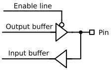

위 그림은 MCU 내부에 들어있는 GPIO 핀 1개의 기본 입출력 구조이다. Enable line 신호가 0일 때, Output buffer가 활성화되고 Input buffer는 비활성화된다.

위 그림은 MCU 내부에 들어있는 GPIO의 출력 버퍼이다. 출력 버퍼는 단순히 1개의 PMOS와 1개의 NMOS로 이루어진 CMOS(Complementary MOS) 구조이다.

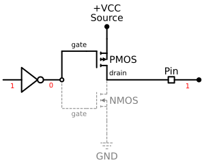

만약 우리가 MCU에서 GPIO 핀으로 1을 출력하고자 할때, 1을 보내면 인버터 로직에 의해 0이 출력되면서 PMOS는 활성화되고, NMOS는 비활성화되면서 microcontroller pin은 1을 출력한다.

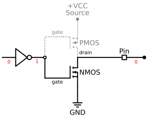

만약 우리가 MCU에서 GPIO 핀으로 0을 출력하고자 할때, 0을 보내면 인버터 로직에 의해 1이 출력되면서 PMOS는 비활성화되고, NMOS는 활성화되면서 microcontroller pin은 0을 출력한다.

---

반대로 Enable line 신호가 1일 때는, Output buffer가 비활성화되고 Input buffer는 활성화된다.

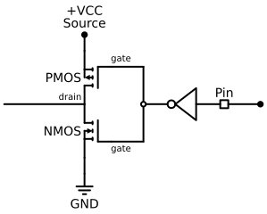

위 그림은 MCU 내부에 들어있는 GPIO의 입력 버퍼이다. 입력 버퍼는 단순히 출력 버퍼를 180도 돌려놓은 구조와 유사하다.

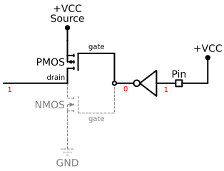

만약 우리가 MCU 외부에서 GPIO 핀으로 1을 입력되면, 인버터 로직에 의해 0으로 출력되면서 PMOS는 활성화되고, NMOS는 비활성화되면서 microcontroller pin은 1을 입력받는다.

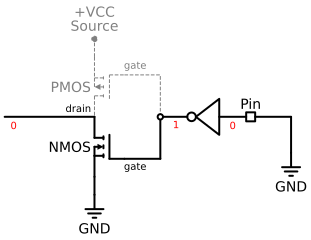

만약 우리가 MCU 외부에서 GPIO 핀으로 0이 입력되면, 인버터 로직에 의해 1이 출력되면서 PMOS는 비활성화되고, NMOS는 활성화되면서 microcontroller pin은 0을 입력받는다.

참고로 Enable line은 GPIO Control Register를 통해 설정할 수 있다.

## GPIO Input Mode

### High Impedance State

High impedance state는 HI-Z state라고도 불리는데, 이는 단순히 VCC 또는 ground와 연결되어 있지 않고 붕 떠있는(floating) 상태를 말한다. 이 때문에 floating state라고도 불린다.

기본적으로 MCU가 켜지면, 모든 GPIO 핀은 input mode 이면서 HIGH-Z state 또는 floating state에 놓이게 된다. GPIO 핀을 floating state로 계속 두면 노이즈에 매우 민감하게 반응하기 때문에 전류 누수가 발생한다.

하지만 오늘날 모든 microcontroller의 입력 버퍼는 Schmitt trigger를 사용하여 노이즈 문제를 해결하고 있다.

### Pull-Up / Pull-Down State

위에서 문제가 되는 floating state는 internal pull-up 또는 internal pull-down 저항을 통해 해결할 수 있다.

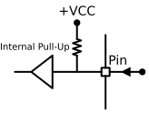

위 그림은 internal pull-up 저항이 활성화된 상태로, GPIO 핀을 1로 유도하여 floating 상태를 방지한다.

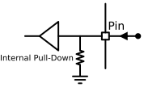

위 그림은 internal pull-down 저항이 활성화된 상태로, GPIO 핀을 0으로 유도하여 floating 상태를 방지한다.

사용하지 않는 GPIO 핀은 누수 전류를 방지하기 위해 internal pull-up 또는 internal pull-down 저항을 활성화시켜 놓는 것이 안전하다.

참고로 internal pull-up 또는 internal pull-down 저항을 어떻게 활성화시킬 수 있을지 궁금할 수 있는데, 이는 configuration register에서 설정할 수 있다.

Internal pull-up/pull-down 외에 External pull-up/pull-down도 있으나 오늘날 대부분의 Microcontroller는 internal pull-up/pull-down을 제공하기 때문에 external pull-up/pull-down을 사용할 필요는 없다.

## GPIO Output Mode

### Open Drain State

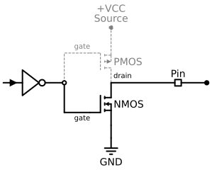

Open-Drain Output Mode는 기본 GPIO 출력 회로에서 상단의 PMOS 트랜지스터를 비활성화하여 NMOS 트랜지스터만 남겨둔 구조다. 이 상태에서 NMOS가 켜지면 핀이 GND와 연결되어 출력 전압이 Low(0)로 떨어진다. 반대로 NMOS가 꺼지면 드레인(Drain) 단자가 어디에도 연결되지 않은 개방(Open) 상태가 되어, 출력 핀은 어떤 전압 상태도 갖지 않는 플로팅(Floating, High-Z) 상태가 된다. '오픈 드레인'이라는 이름도 바로 이 특성에서 유래했다.
결과적으로 오픈 드레인 구조는 핀의 전압을 GND로 끌어내릴 수만 있고, 스스로 High(1) 상태로 밀어 올릴 능력은 없다. 따라서 핀의 출력 상태는 Low 아니면 플로팅 상태로 제한된다.
이대로는 논리적인 '1(High)' 신호를 출력할 수 없으므로, 오픈 드레인을 제대로 활용하려면 반드시 핀의 전압을 끌어올려 줄 내부 풀업(Internal Pull-up) 또는 외부 풀업(External Pull-up) 저항을 함께 사용해야 한다.

### Open Drain with Pull-Up

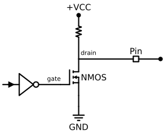

위 그림은 오픈 드레인과 internal pull up을 함께 사용한 회로이다. Internal pull up과 함께 사용하기 때문에 이 회로의 출력 핀은 Low(0)가 되거나 High(1) 상태를 출력할 수 있다.

앞에서도 말했듯이 오늘날 대부분의 Microcontroller는 internal pull-up을 제공하기 때문에 external pull-up을 사용할 필요는 없다.

### Push-Pull State

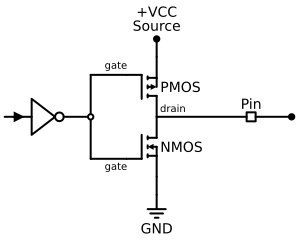

GPIO 핀을 Output Mode로 설정하면 위 그림과 같은 Push-Pull 구조로 동작한다. 2개의 트랜지스터가 번갈아 가며 출력 전압을 HIGH로 밀어 올리거나(Push) LOW로 끌어내리며(Pull) 상태를 전환하기 때문에 '푸시풀'이라는 이름이 붙었다.

이 구조에서는 트랜지스터가 스스로 출력 상태를 확고하게 결정하므로 별도의 풀업(Pull-up)이나 풀다운(Pull-down) 저항(Resistor)이 필요하지 않다. 출력을 HIGH로 만들 때는 상단의 PMOS 트랜지스터가 켜지고, LOW로 만들 때는 하단의 NMOS 트랜지스터가 켜지면서 핀의 전압을 확실하게 제어한다.
