+++
date = '2026-10-24T11:00:22+09:00'
# draft = true
title = '05. GPIO - 2'
+++

## GPIO Programming structure

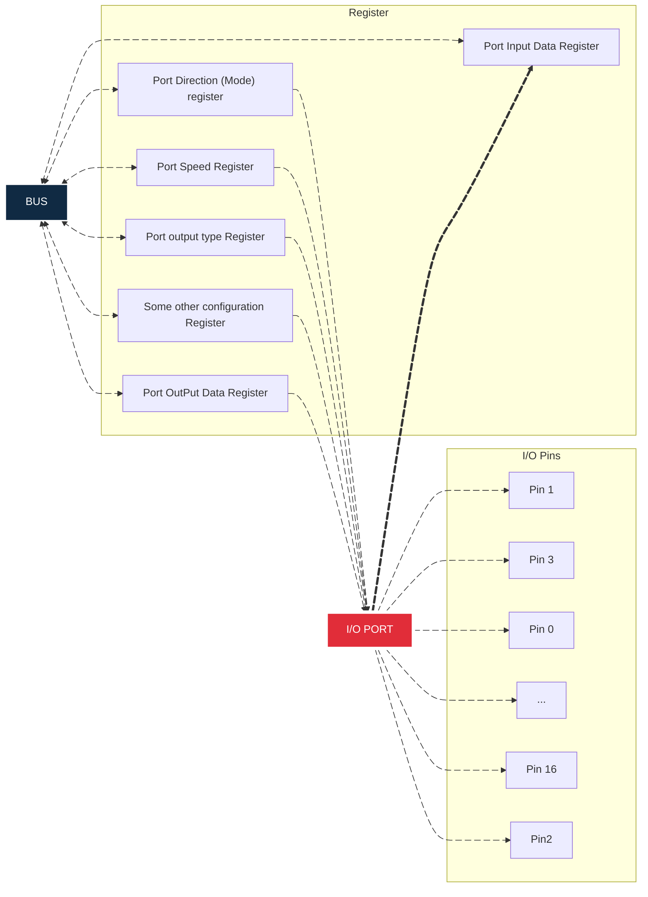

GPIO Port는 다양한 레지스터에 의해 제어된다. 레지스터들은 vendor에 따라 다르게 디자인되지만, 일반적으로 위 그림과 같은 레지스터들로 구성되어있다.

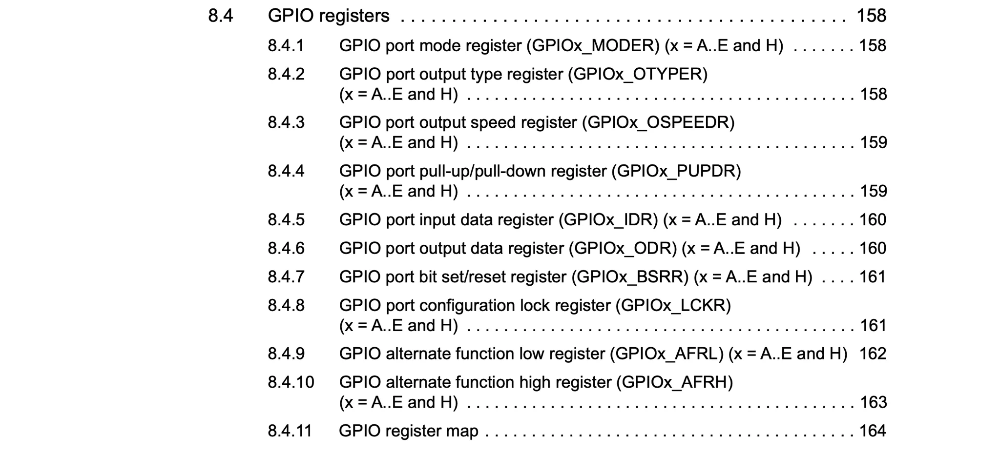

GPIO Port를 제어할 수 있는 레지스터는 위와 같이 Reference Manual에서 확인할 수 있다.

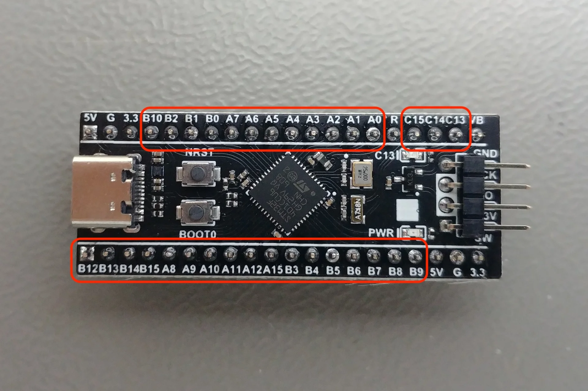

참고로 모든 GPIO register는 AHB1 버스를 통해 프로세서와 연결되어 있으며, GPIO 핀은 제품 헤더를 통해 연결할 수 있다.

## GPIO Port Register

### GPIO Port Mode Register

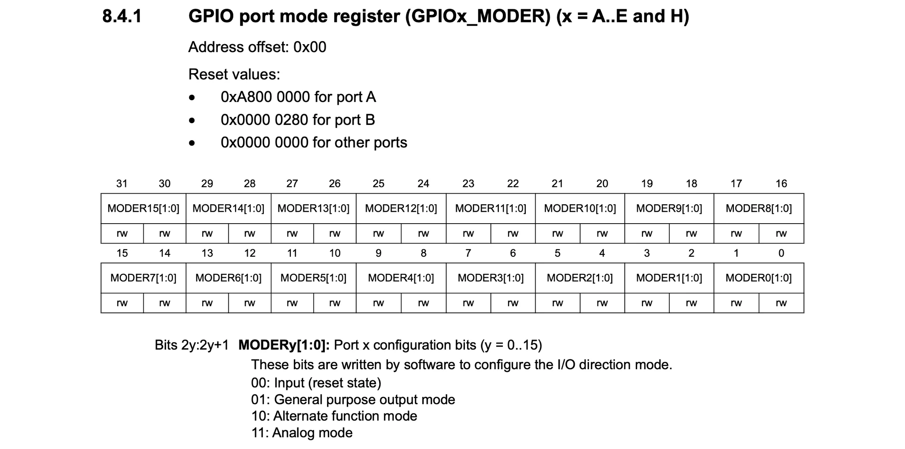

GPIO Port의 갯수는 A부터 H까지 총 8개이며, Mode register는 각 GPIO Port의 16개 핀의 역할을 제어하는 레지스터이다. 주의할 점은 문서에 나와있듯이 GPIO Port A의 reset value는 0x00020000이고 GPIO Port B의 reset value는 0x00000000 이라는 사실이다. 다른 GPIO는 reset value가 0이다.

`MODER0[1:0]`는 Pin 0번의 제어 모드를 의미하고, `MODER1[1:0]`는 Pin 1번의 제어 모드를 의미한다. 마찬가지로 `MODER15[1:0]`는 Pin 15번의 제어 모드를 의미한다.

제어 모드에는 `Input`, `General purpose output mode`, `Alternate function mode`, `Analog mode`가 있다. GPIO를 사용하기 전에는 반드시 이 모드를 미리 지정해야 한다.
또한 기억해야 할 것은 internal pull-up/pull-down 저항은 기본적으로 비활성화 되어 있으므로, floating state를 방지하기 위해 레지스터에서 적절히 설정해야 노이즈가 발생하지 않는다.

#### Input Mode

Input mode는 외부의 디지털 신호를 내부로 읽어들이는 모드이다. 평소 또는 동작 시 신호가 LOW(0)로 떨어지는 회로에는 internal pull-up을, HIGH(1)로 올라가는 회로에는 internal pull-down을 적용해야 안정적인 입력 값을 보장받을 수 있다.

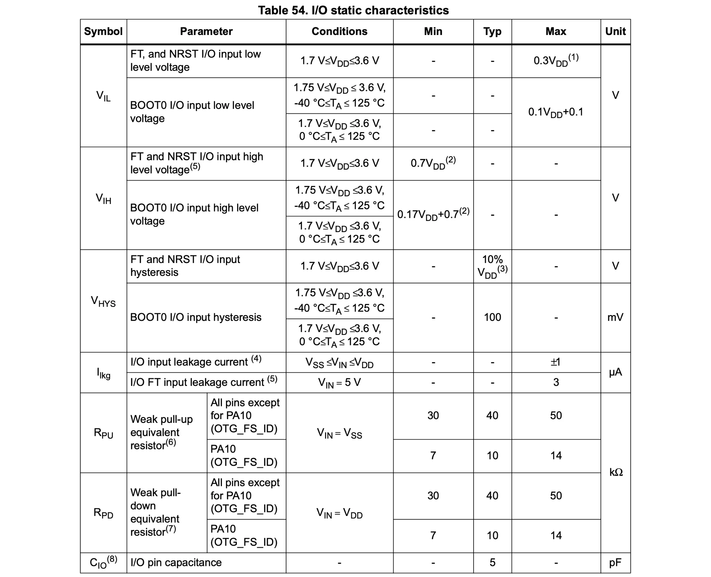

Internal pull-up/pull-down 저항의 상세 정보는 Product Specification에서 확인할 수 있다. 위 표에서 $\text{R}_{\text{PU}}$는 internal pull-up을 의미하고, $\text{R}_{\text{PD}}$는 internal pull-down을 의미한다.
위 표를 보면 internal pull-up은 최소 30kΩ, 최대 50kΩ, 기본 40kΩ을 갖는다는 것을 알 수 있다. 예외적으로 PA10의 internal pull-up은 최소 7kΩ, 최대 14kΩ, 기본 10kΩ을 갖는다.

#### Output Mode

Output mode에서는 open-drain 또는 push-pull로 출력 설정을 할 수 있다.

Push-pull 설정에서는 PMOS와 NMOS 트랜지스터를 동시에 사용하며, MCU 내부에서 쓰는 신호에 따라 PMOS와 NMOS가 스위칭되면서 신호가 HIGH 또는 GND 상태가 된다.

Open-Drain 설정에서는 PMOS를 사용하지 않기 때문에 오직 발생시키는 출력값은 LOW 또는 floating 뿐이다. Floating 문제를 해결하기 위해 반드시 internal pull-up 저항을 활성화해야 한다. 하지만 주변장비에서 필요로 하는 전류가 internal pull-up 저항이 매우 크기 때문에 충분히 공급되지 않는 경우 external pull-up 저항을 따로 추가해야 할 수도 있다.

그렇다면 언제 Open-Drain을 사용하고 언제 Push-pull을 사용해야 할까? 이는 사용하려는 주변장치의 종류에 따라 달라진다. Output 핀에 LOW/HIGH 2개 상태를 필요로 하는 LED 또는 모터와 같은 경우 push-pull 설정을 사용해도 괜찮다. 만약 HIGH 상태만 필요로 하는 I2C 통신과 같은 Serial 통신 프로토콜의 경우 open-drain 설정을 사용해야만 한다.

참고로 Output mode를 활성화되었다고 해서 Input mode가 비활성화되지는 않는다. Output mode가 활성화될때 Input mode도 활성화되어 있다. 반대의 경우도 마찬가지이다. 이 말은 Output mode에서도 I/O 핀을 통해 Input 데이터 레지스터에서 I/O 상태를 읽을 수 있다는 의미이다.

#### Alternate Function Mode

Alternate function mode를 사용하면 I/O 핀은 일반적인 GPIO 기능을 벗어나 UART(TX/RX), Timer Input 채널, ADC Input, SPI Clock, I2C 데이터 라인(SDA/SCL) 등 내부 주변장치(Peripheral)의 전용 신호로 전환되어 동작한다.

이 모드에서 MCU가 I2C_SDA, I2C_SCL, UART_TX 등을 통해 외부로 데이터를 내보낼 때(출력)는 일반적인 Output data 레지스터를 거치지 않고 해당 주변장치의 내부 하드웨어에 의해 직접 제어된다.
반대로 UART_RX, 타이머 캡처 채널, CAN_RX 등을 통해 외부에서 데이터를 받아올 때(입력)는 내부 주변장치가 신호를 직접 수신하는 동시에, Input data 레지스터에도 관련 상태가 실시간으로 업데이트된다.

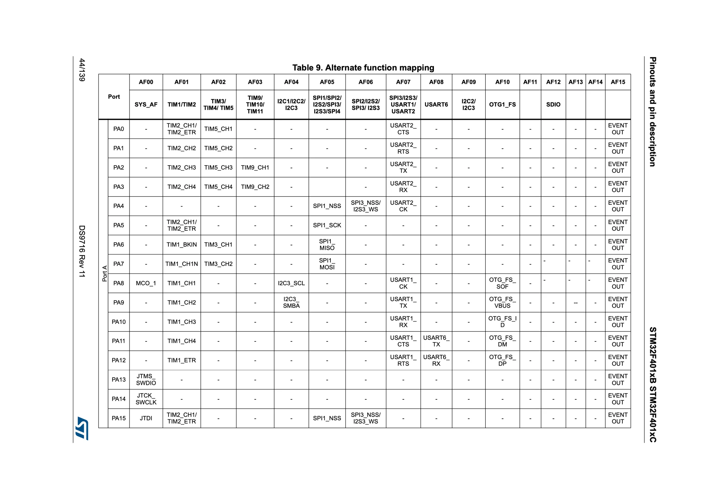

각 GPIO Port에서 사용할 수 있는 Alternate function은 Production Specification에서 찾을 수 있다.

### GPIO Port Output Type Register

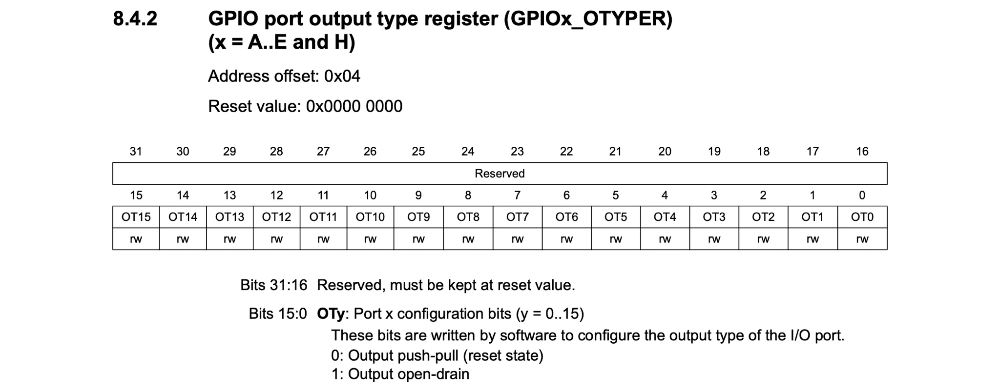

GPIO port mode 레지스터에서 Output mode를 설정했다면, 위 레지스터에서 어떤 output type을 사용할 것인지 선택해야 한다.

### GPIO Port Output Speed Register

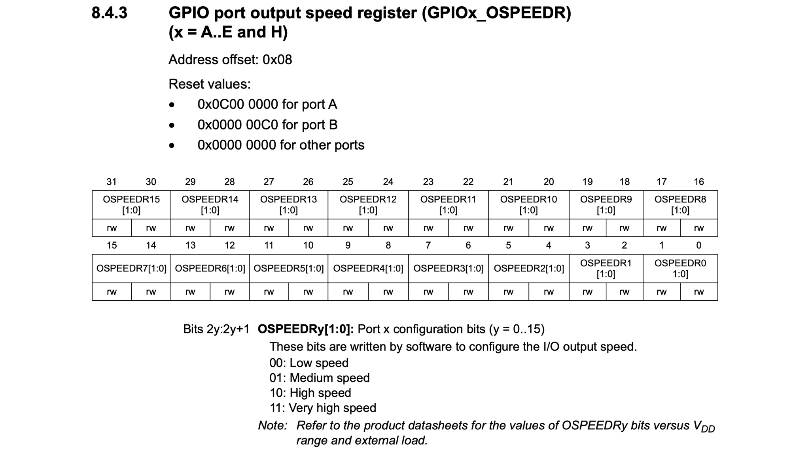

GPIO port mode 레지스터에서 Output mode로 설정했다면, 위 레지스터에서 얼마나 빠른 속도로 HIGH에서 LOW로 또는 LOW에서 HIGH로 전환할 것인지를 설정할 수 있다. 즉 해당 핀의 slew rate(단위 시간 동안 출력 전압의 변화량)를 제어할 수 있다는 의미이다.

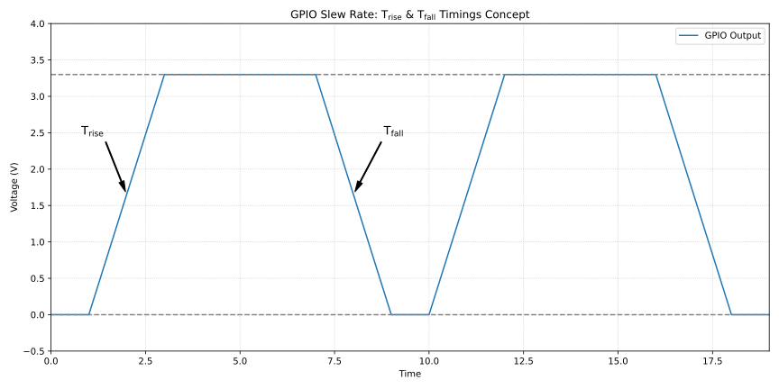

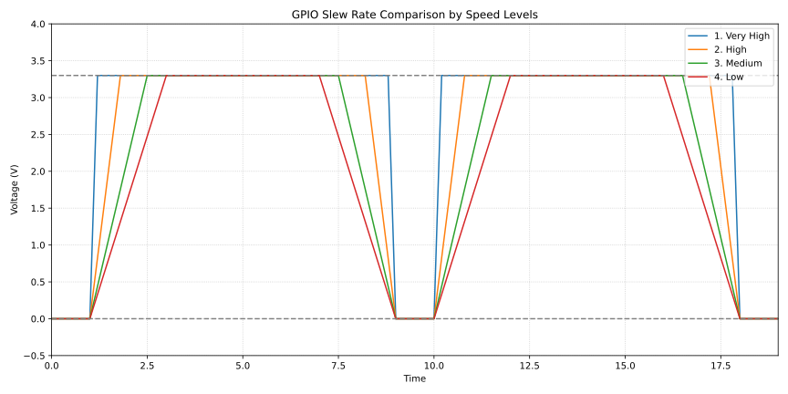

위 그래프에서 $\text{T}_\text{rise}$는 LOW에서 HIGH로 전환되는데 걸리는 시간을 의미한다. $\text{T}_\text{fall}$은 HIGH에서 LOW로 전환하는데 걸리는 시간을 의미한다.

Output Speed 레지스터는 $\text{T}_\text{rise}$와 $\text{T}_\text{fall}$의 시간을 제어할 수 있다.

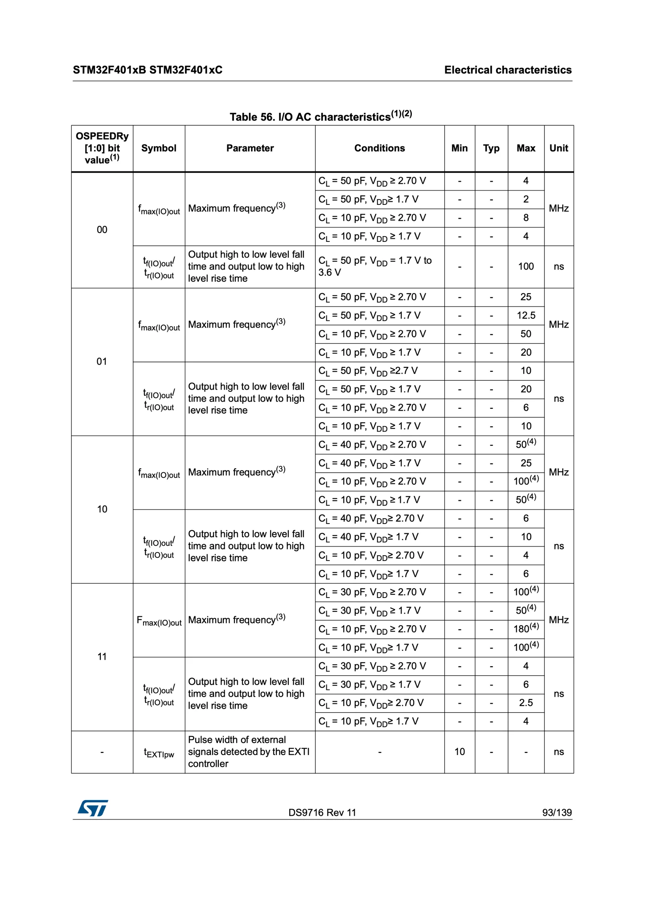

Slew rate에 대한 상세 정보는 production specification에서 찾을 수 있다. 위 표에서 $\text{V}_\text{DD}$는 Microcontroller에 공급되는 전압을, $\text{C}_\text{L}$은 load capacitance를 의미한다. 표를 살펴보면 설정 비트가 00에서 11로 증가할수록 Max unit이 점점 커지는 것을 볼 수 있다.

참고로 대부분의 경우 output speed 레지스터를 기본값 그대로 사용해도 괜찮다. 다만, 비트뱅잉(Bit-banging) 방식을 사용하는 I2C 통신 등 정밀한 타이밍 제어가 필요한 특수한 상황에서는 해당 레지스터 값을 수동으로 설정해야 한다.

### GPIO Port Pull-Up/Pull-Down Register

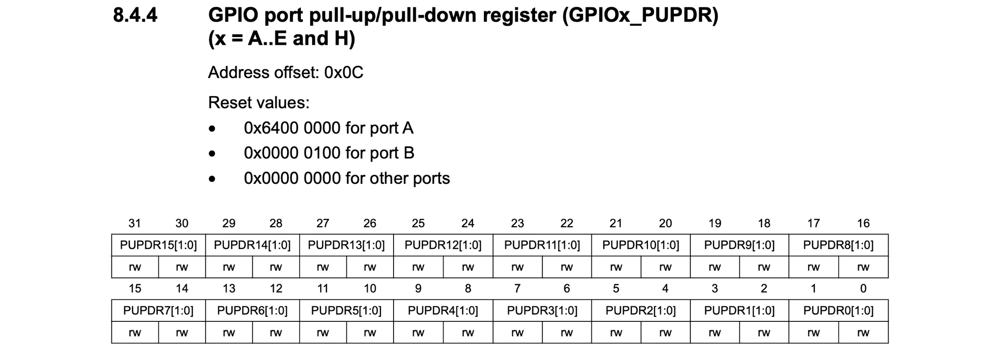

### GPIO Port Input Data Register

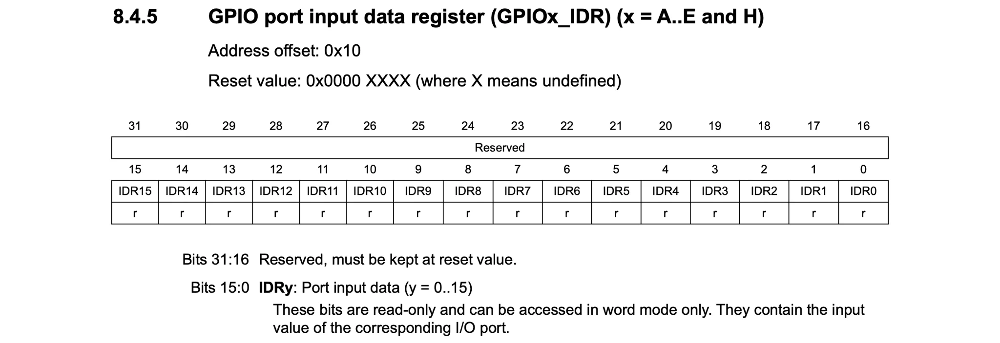

해당 레지스터는 매 AHB1 bus 클럭 사이클마다 해당 GPIO port의 입력 데이터가 업데이트 된다.

### GPIO Port Output Data Register

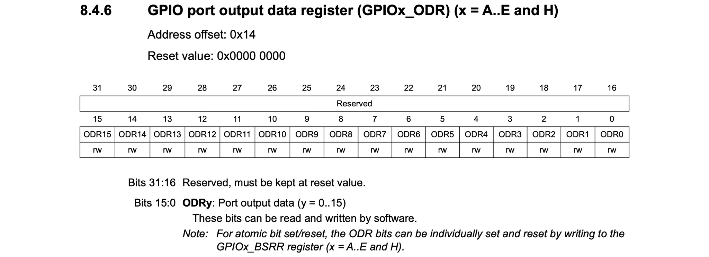

`ODR0`을 1로 설정하면 GPIO 0번 핀에 HIGH 신호를 출력하고, `ODR0`를 0으로 설정하면 GPIO 0번 핀에 LOW 신호를 출력한다는 의미이다.

---

위 레지스터 설정을 조합해서 아래와 같은 다양한 설정을 가진 GPIO 핀을 만들 수 있다.

| GPIO 모드 | MODER | OTYPER | PUPDR |
| :--- | :--- | :--- | :--- |
| Input floating | Input (00) | - | No Pull (00) |
| Input pull-up | Input (00) | - | Pull-up (01) |
| Input pull-down | Input (00) | - | Pull-down (10) |
| Analog | Analog (11) | - | No Pull (00) |
| Output open-drain (w/ Pull-up/down) | Output (01) | Open-Drain (1) | 선택 가능 (None / Up / Down) |
| Output push-pull (w/ Pull-up/down) | Output (01) | Push-Pull (0) | 선택 가능 (None / Up / Down) |
| Alternate function push-pull (w/ Pull-up/down) | Alternate (10) | Push-Pull (0) | 선택 가능 (None / Up / Down) |
| Alternate function open-drain (w/ Pull-up/down) | Alternate (10) | Open-Drain (1) | 선택 가능 (None / Up / Down) |

### GPIO Alternate Function registers

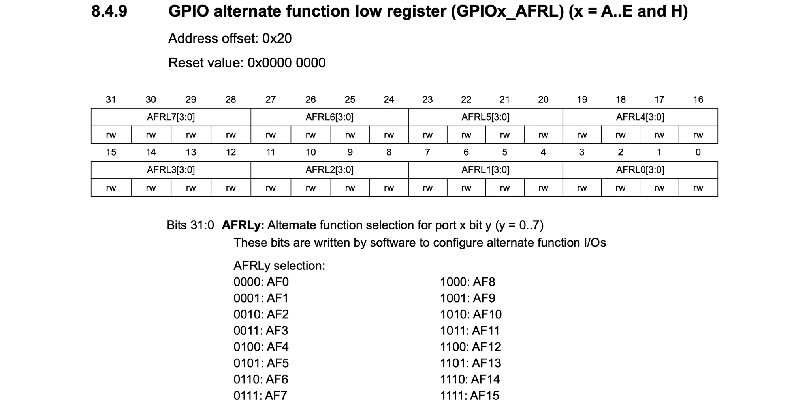
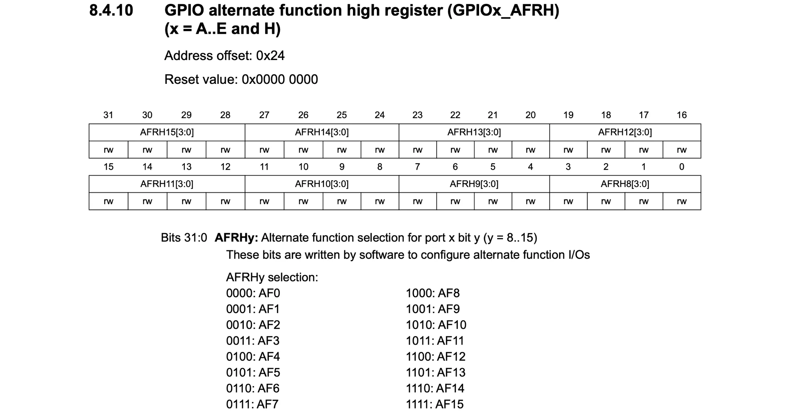

해당 레지스터는 Low 레지스터와 High 레지스터로 나뉘며, Low 레지스터는 0부터 7번 핀까지의 핀을,  High 레지스터는 8부터 15번 핀의 설정을 담당한다.

선택 가능한 대체 기능이 총 16가지가 되므로, 이를 표현하기 위해 각 핀당 4비트 공간을 할당하여 사용한다.
