+++
date = '2026-11-04T15:12:57+09:00'
# draft = true
title = '06. GPIO Pin Specification'
+++

## Absolute Maximum Ratings

Production Specification에는 AMR(Absolute Maximum Ratings)에 대한 내용이 있는데, 여기에는 MCU 칩에 대한 허용가능한 전압, 전류, 온도 특성이 적혀있다.

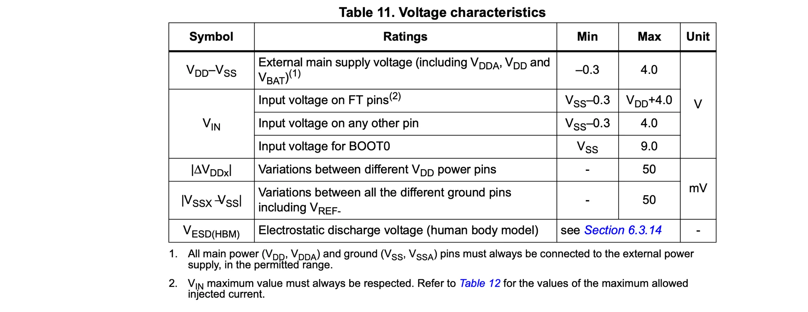

위 표는 전압 특성에 대한 내용으로, $\text{V}_\text{DD}$는 MCU로 공급되는 외부에서 공급되는 main power supply를 의미하며, 이는 MCU가 $\text{V}_\text{DD}$ 파워 핀을 통해 외부에서 공급된다는 것을 말한다.

MCU가 정상적으로 동작하기 위한 $\text{V}_\text{DD}$는 $1.8 \text{V} \le \text{V}_\text{DD} \le 3.6 \text{V}$ 이다. 만약 $1.8 \text{V}$보다 낮은 전압이 인가되면 MCU는 정상적으로 동작하지 못한다.

위 표에 따르면, MCU가 수용할 수 있는 $\text{V}_\text{DD}$의 최대 전압은 $4 \text{V}$이다. 이는 Symbol 칼럼의 $\text{V}_\text{DD}-\text{V}_\text{SS}$ 항목의 MAX 컬럼에서 확인할 수 있다. 만약 이를 초과하면 MCU는 고장날 수 있다. 때문에 어떤 MCU를 사용하던, AMR을 확인해서 적절한 전압을 확인해야만 한다.

$\text{V}_\text{SS}$는 MCU의 ground reference를 의미하며 이는 $0 \text{V}$로 유지되어야 하나, 위 표에 따르면 $\text{V}_\text{SS}$는 최소 $-0.3 \text{V}$까지 허용된다. 이는 Symbol 칼럼의 $\text{V}_\text{DD}-\text{V}_\text{SS}$ 항목의 MIN 컬럼에서 확인할 수 있다.

### General Operating Conditions

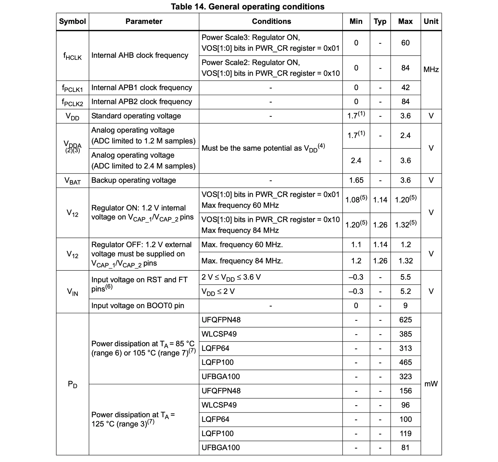 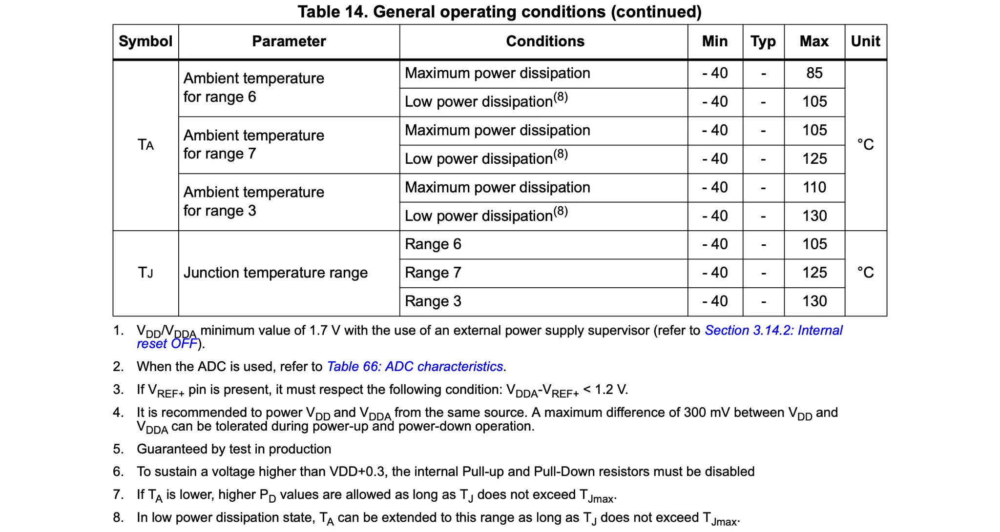

General operating condition은 MCU가 정상 동작을 보장하는 조건에 대해 설명한다. 그렇기 때문에, MCU의 $\text{V}_\text{DD}$ 핀에 전압을 공급하기 전에 이 조건을 반드시 확인해야 한다. MCU의 정상 동작을 위해서는 전압뿐만 아니라 동작 주파수 및 온도 조건도 함께 고려해야 한다.

$\text{V}_\text{DD}$ 항목을 확인해보면, 해당 칩은 $1.7 \text{V} \sim 3.6 \text{V}$ 범위에서 동작이 보장된다. $\text{V}_\text{DDA}$는 MCU의 아날로그 블록에 사용되는 전압으로, ADC, DAC과 같은 아날로그 주변장치에 공급되는 전압을 의미한다.

#### $\text{V}_\text{IN}$

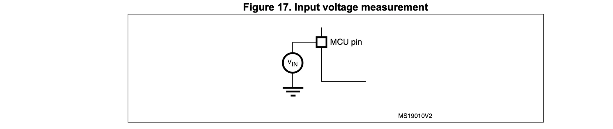

$\text{V}_\text{IN}$은 MCU I/O 핀에 인가되는 입력 전압을 말한다.

STM32 Microcontroller는 주로 2가지 종류의 GPIO 핀을 구조를 가진다. 하나는 $\text{TT}$(Three volt tolerant), 다른 하나는 $\text{FT}$(Five-volt tolerant)이다.
$\text{TT}$는 $3.3 \text{V}$ 전압을 수용할 수 있는 GPIO 핀이고, $\text{FT}$는 $5 \text{V}$ 전압을 수용할 수 있는 GPIO 핀을 의미이다.
$\text{TT}$, $\text{FT}$ 외에 $\text{TTa}$ 핀도 존재하는데, 이는 $\text{TT}$이면서 ADC 등 아날로그 주변장치와 연결되는 핀을 의미하며, $\text{TT}$와 동일하게 생각해도 된다.

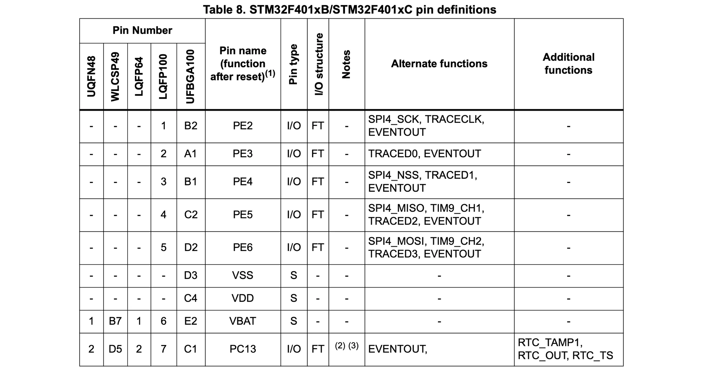

위 테이블을 보면 각 GPIO 핀의 I/O 구조를 알 수 있는데, 현재 사용하는 STM32F401CCU6의 모든 GPIO 핀은 $\text{FT}$이다. 하지만, 다른 칩의 경우 특정 GPIO 핀이 $\text{TT}$ 일수도 있으니 확인이 필요하다. GPIO 핀의 I/O 구조가 $\text{TT}$일때, $3.3 \text{V}$ 이상의 전압이 들어오면 다이오드에 손상될 수 있기 때문이다.

#### Three-volt Tolerant pin ($\text{TT}$ or $\text{TTa}$)

최대 $\text{V}_\text{IN}$ 전압은 $\text{V}_\text{DD} + 0.3 \text{V}$ 이다. 이를 초과하면 $\text{TT(a)}$ 핀이 손상을 입거나 칩 자체에 장애가 생길 수 있다.

$\text{TT(a)}$ 핀에 대한 general operating condition은 $\text{V}_\text{SS} -0.3  \text{V} \le \text{V}_\text{IN} \le \text{V}_\text{DD} + 0.3 \text{V}$ 이다.

STM32 Microcontroller가 전원이 꺼져있어서 $\text{V}_\text{DD} = 0$인 경우, GPIO의 $\text{TT}$ 핀의 $\text{V}_\text{IN} \gt 0.3 \text{V}$가 되어서는 안된다.

#### Five-volt Tolerant pin ($\text{FT}$)

GPIO 핀이 $\text{FT}$ I/O 구조를 갖는다는 의미는 $-0.3 \text{V} \le \text{V}_\text{IN} \le 5.5 \text{V}$ 범위의 전압이 들어올 때 Voltage protection이 보장된다는 의미이다. 회로로 들어오는 전압이 특정 기준치(상한선이나 하한선)를 넘어가지 못하도록 강제로 제한하는 보호 다이오드를 통해 Voltage protection가 보장된다.

GPIO는 오직 Input mode에서만 $\text{FT}$를 사용할 수 있으며, Output mode나 analog 모드에서는 사용할 수 없다. GPIO $\text{FT}$ 핀의 최대 $\text{V}_\text{IN}$은 $\text{V}_\text{DD} + 4\text{V}$ 이다.

$\text{FT}$ 핀에 대한 general operating condition은 $\text{V}_\text{SS} -0.3  \text{V} \le \text{V}_\text{IN} \le 5.5 \text{V}$이다. 즉, $\text{FT}$ 핀은 어떠한 경우에서도 $\text{V}_\text{IN} \gt 5.5 \text{V}$이 되어서는 안된다.

STM32 Microcontroller가 전원이 꺼져있어서 $\text{V}_\text{DD} = 0$인 경우, GPIO의 $\text{FT}$ 핀의 $\text{V}_\text{IN} \gt 4 \text{V}$가 되어서는 안된다.

### Current Characteristics

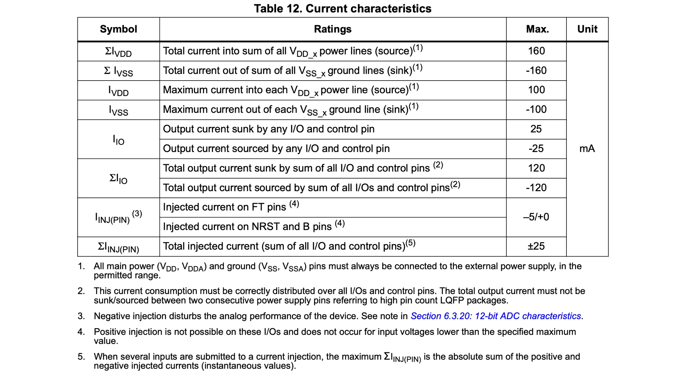

$\text{I}_\text{VDD}$는 $\text{V}_\text{DD}$ power line으로 흘러 들어가는 전체 전류를 의미한다. $\text{I}_\text{VSS}$는 $\text{V}_\text{SS}$ ground line에서 흘러 나가는에서 전체 전류를 의미한다.

$\text{I}_\text{IO}$에는 2가지 종류의 전류가 있는데, 하나는 MCU에서 외부로 흘러 나가는 source current이고, 다른 하나는 MCU로 흘러 들어오는 sink current이다.

#### I/O Source Current

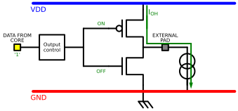

핀 출력이 HIGH('1')일 때, 내부 PMOS가 켜지면서 칩 내부($\text{V}_\text{DD}$)에서 외부 회로로 전류가 흘러 나간다. 참고로 핀 하나당 안전하게 흘려보낼 수 있는 최대 전류는 보통 $25 \text{mA}$로 제한된다.

#### I/O Sink Current

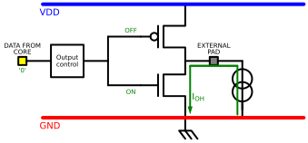

핀 출력이 LOW('0')일 때, 내부 NMOS가 켜지면서 외부 회로의 전류가 핀을 타고 들어와 접지($\text{V}_\text{SS}$)로 빠져나간다. 참고로 핀 하나당 최대 $25 \text{mA}$를 넘으면 칩이 손상될 수 있다.

---

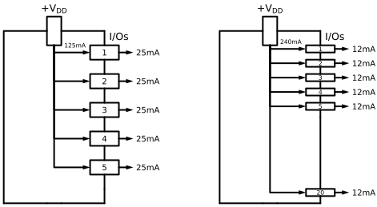

5개의 I/O 핀을 사용할 떄는 각 핀에 충분히 $25 \text{mA}$를 공급할 수 있지만, 사용하는 핀이 많아질수록 칩 전체의 전원 라인이 버티는 총 전류 한계 때문에 각 핀에 할당되는 전류가 줄어든다.

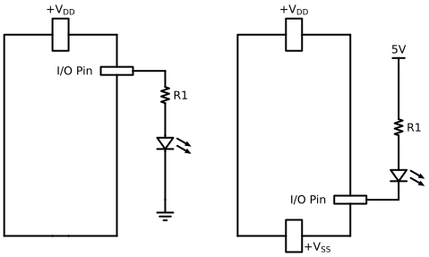

왼쪽은 Current Sourcing 방식으로, MCU 핀에서 전류를 밖으로 내보내는 구조이다. 따라서 핀 출력을 HIGH(1)로 해야 LED가 켜진다.

오른쪽은 Current Sinking 방식으로, 외부 전원으로부터 온 전류를 MCU 핀이 GND로 가져오는 구조이다. 따라서 핀 출력을 LOW(0)로 해야 LED가 켜진다.

#### Injected Current($\text{I}_\text{INJ}$)

문서를 읽다보면, injected current란 단어가 나온다. Injected current란 전원 전압($\text{V}_\text{DD}$)보다 높거나 접지($\text{V}_\text{SS}$)보다 낮은 입력 전압($\text{V}_\text{IN}$) 때문에 핀으로 강제로 밀려 들어오는 전류를 말한다.
규격에 명시된 한계를 초과하는 injected current는 칩 내부로 전류가 흐르게 만들어 신뢰성에 악영향을 준다.

Injected current에는 2종류가 있다. 하나는 Positive-injection current이고, 나머지 하나는 Negative-injection current이다.

Negative-injection current는 $\text{V}_\text{IN} < \text{V}_\text{SS}$일 때 유도되는 전류이다. 최대 허용 negative-injection current는 $-5 \text{mA}$이며, $\text{TT}$ 및 $\text{FT}$ GPIO에서 수용 가능한 최소 입력 전압($\text{V}_\text{IN}$)은 $-0.3 \text{V}$이다.

Positive-injection current는 $\text{V}_\text{IN} > \text{V}_\text{DD}$일 때 유도되는 전류이다. STM32 기기에서 $\text{FT}$ GPIO의 최대 양의 주입 전류는 $\text{N/A}$ 또는 $0 \text{mA}$ 이다. 즉, 전류가 주입될 경우 GPIO가 손상되고 STM32가 오동작할 수 있음을 의미이므로, $0 \text{mA}$로 규정된 $\text{TT}$ 또는 $\text{FT}$ GPIO에는 positive-injection current 주입이 금지된다.

$\text{FT}$ 핀의 입력 전압($\text{V}_\text{IN}$)이 AMR($\text{V}_\text{DD} + 4 \text{V}$)보다 낮은 동안에는 positive-injection current가 발생하지 않는다. 상한선인 $0 \text{mA}$는 GPIO 핀으로 양의 주입 전류가 절대 흘러 들어가서는 안 되며, 그렇지 않으면 기기가 손상될 수 있다. 만약 $\text{V}_\text{IN}$이 $\text{V}_\text{DD} + 4 \text{V}$를 초과하면 positive-injection current이 발생하며, 주입 전류가 데이터시트에 명시되지 않은 임계값을 넘을 경우 칩이 손상될 수 있다.

따라서 $0 \text{mA}$로 정의된 $\text{FT}$ GPIO에는 양의 전류 주입이 금지된다는 점을 명심해야 한다.

### Logic Levels

로직 레벨은 Logic 0에 대한 전압 threshold와 Logic 1에 대한 전압 threshold를 말한다. 이는 단지 STM32 microcontroller에 국한된 것이 아닌, 모든 microcontroller 에 해당한다.

모든 I/O 핀은 CMOS 및 TTL 로직 레벨과 호환된다. 참고로 CMOS와 TTL은 디지털 회로에서 0과 1신호를 표현하고 구별하기 위해 사용하는 반도체 회로 기술(Logic Family)의 종류이다.

### Logic Level Compatibility

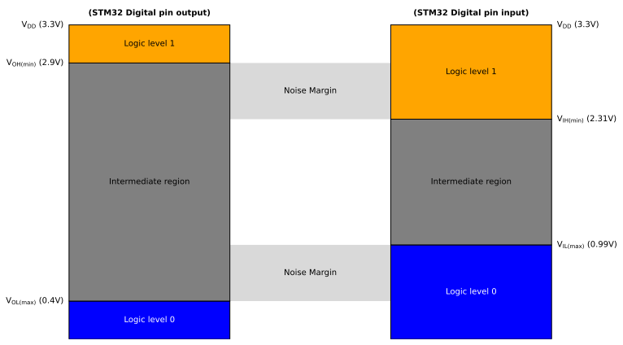

2개의 MCU를 사용하여 통신을 할때, logic level compatibility를 고려해야만 한다. 그렇지 않으면 두 MCU는 서로 통신이 불가능하거나 손상될 수 있다.

위 그림은 STM32간의 통신할 때의 Logic Level를 나타낸 것이다. 그림에 나타난 것처럼 STM32의 출력 신호는 수신(Receptor) 장치의 $\text{V}_\text{IL}$/$\text{V}_\text{IH}$(입력 전압 기준)와 호환되어야 하며, STM32의 입력은 송신(Transmitter) 장치의 $\text{V}_\text{OL}$/$\text{V}_\text{OH}$(출력 전압 기준)를 만족해야 한다.

여기서 4개의 $\text{V}_\text{IL}, \text{V}_\text{IH}, \text{V}_\text{OL}, \text{V}_\text{OH}$ 전압이 소개되는데, $\text{V}_\text{IL}, \text{V}_\text{IH}$는 input threshold 전압에 대한 것이고, $\text{V}_\text{OL}, \text{V}_\text{OH}$는 output threshold 전압에 대한 것이다. 예를 들어 송신장치에서 수신장치로 Logic 1을 정상적으로 전달하려면, $\text{V}_\text{OH} \ge \text{V}_\text{IH}$ 여야만 한다.

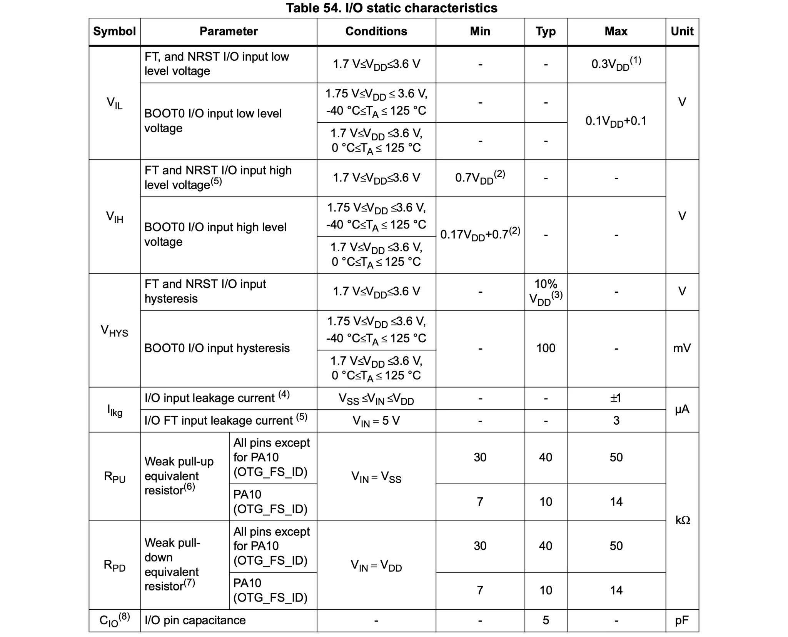

STM32 MCU의 $\text{V}_\text{IL}$/$\text{V}_\text{IH}$ threshold 값은 Production Manual에 적혀있다.

$\text{V}_\text{IL}$은 Logic 0을 해석하기 위한 최대 전압 threshold이다.
위 테이블에 따르면 $\text{V}_\text{IL}$의 MAX 값이 $0.3 \text{V}_\text{DD}$ 이므로, 만약 $\text{V}_\text{DD} = 3\text{V}$ 라면  $0.9 \text{V}$은 Logic 0을 해석하기 위한 최대 전압이가 된다.
따라서 신호의 전압이  $0.9 \text{V}$ 보다 높다면 해당 신호는 Logic 1로 인식될 여지가 있다.

$\text{V}_\text{IH}$은 Logic 0을 해석하기 위한 최소 전압 threshold이다.
위 테이블에 따르면 $\text{V}_\text{IH}$의 MIN 값은 $0.7 \text{V}_\text{DD}$ 이다.

CMOS 포트에서 Input threshold 전압은 공급 전압($\text{V}_\text{DD}$)에 비례하여 다음과 같이 결정된다

- $\text{V}_\text{IH(min)}: 2/3 \text{V}_\text{DD}$
- $\text{V}_\text{IL(max)}: 1/3 \text{V}_\text{DD}$

TTL 포트에서는 로직 레벨이 다음과 같이 고정되어 있다.

- $\text{V}_\text{IH(min)}: 2 \text{V}$
- $\text{V}_\text{IL(max)}: 0.8 \text{V}$

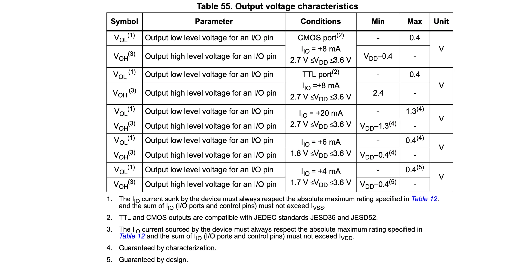

STM32 MCU의 $\text{V}_\text{OL}$/$\text{V}_\text{OH}$ threshold 값은 Production Manual에 적혀있다.

$\text{V}_\text{OL}$은 Logic 0을 해석하기 위한 최대 전압 threshold이다.

$\text{V}_\text{OH}$은 Logic 1을 해석하기 위한 최소 전압 threshold이다.

위 테이블에 따르면 CMOS 포트를 사용하는 $\text{V}_\text{OH}$의 경우, $\text{V}_\text{DD} = 3.3 \text{V}$ 라면 $\text{V}_\text{OH}$의 최소 전압은 $2.9 \text{V}$를 가진다. $\text{V}_\text{OH}$의 최대 전압은 $0.4 \text{V}$ 이다.

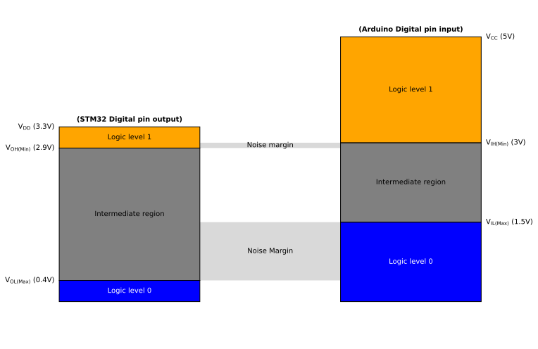

위 그림은 STM32에서 Arduino로 신호를 보낼때의 Logic Level을 나타낸 것이다.

그림에 나타난 것처럼 STM32의 Logic 0의 출력 신호는 Arduino의 수신(Receptor) 장치 기준치를 잘 만족하므로 Logic 0을 전달하는데 문제가 없다.

반면, STM32에서 Logic 1을 출력하는데 $\text{V}_\text{OH}$의 최소 전압은 $2.9 \text{V}$이지만, Arduino의 수신(receptor) 장치의 $\text{V}_\text{IH}$의 최소 전압이 $3 \text{V}$ 이므로 중간에 간극이 생긴다. 따라서 STM32에서 보낸 Logic 1을 Arduino에서 정상적으로 수신하지 못할 수 있다. 이처럼 $3.3 \text{V}$ 보드의 출력 전압이 $5 \text{V}$ 보드의 입력 기준보다 낮을 경우 단순 직접 연결 대신 더 높은 전압으로 바꿔주는 logic level shifter와 같은 변환 장치가 필요하다.

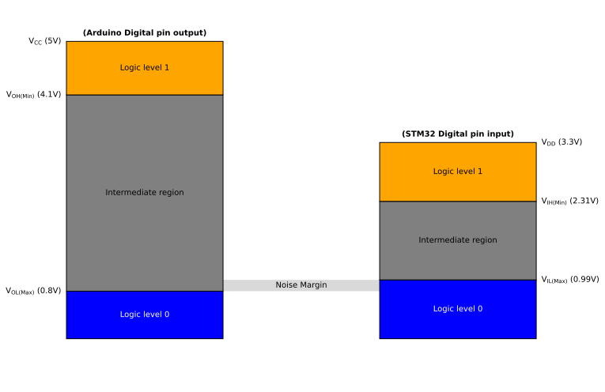

반대의 경우를 살펴보자. 위 그림은 Arduino에서 STM32로 신호를 보낼때의 Logic Level을 나타낸 것이다.

Low 영역을 살펴보면, 송신(Transmitter) 장치의 $\text{V}_\text{OL(Max)} (0.8 \text{V})$와 수신(Receptor) 장치의 $\text{V}_\text{IL(Max)} (0.99 \text{V})$ 사이의 noise margin이 매우 좁을 것을 볼 수 있다. 이는 전기적 노이즈가 살짝만 튀어도 Logic 0이 Logic 1로 오인될 수 잇어 통신이 매우 불안정해진다.

High 영역을 살펴보면, 송신(Transmitter) 장치의 $\text{V}_\text{OH(Min)} (4.1 \text{V})$가 수신(Receptor) 장치의 $\text{V}_\text{IH(Min)} (2.31 \text{V})$ 보다 훨씬 높기 때문에 Logic 1은 안전하게 전달되어 진다. 다만, STM32 전원이 꺼진 상태인 경우 외부의 $5 \text{V}$ 고전압이 핀으로 들어오면, 보호 다이오드를 통해 전류가 칩 내부로 역류하여 칩을 손상시킬 수 있다. 때문에 다이오드나 logic level shifter와 같은 전압 변환 장치를 반드시 사용해야 한다.
