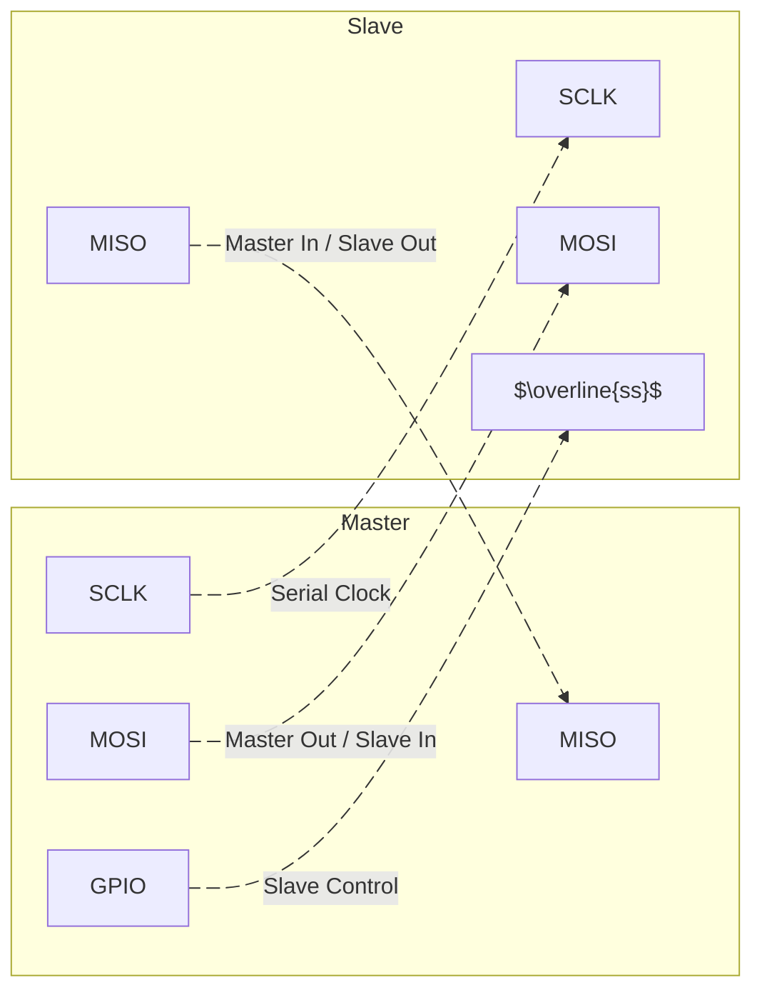
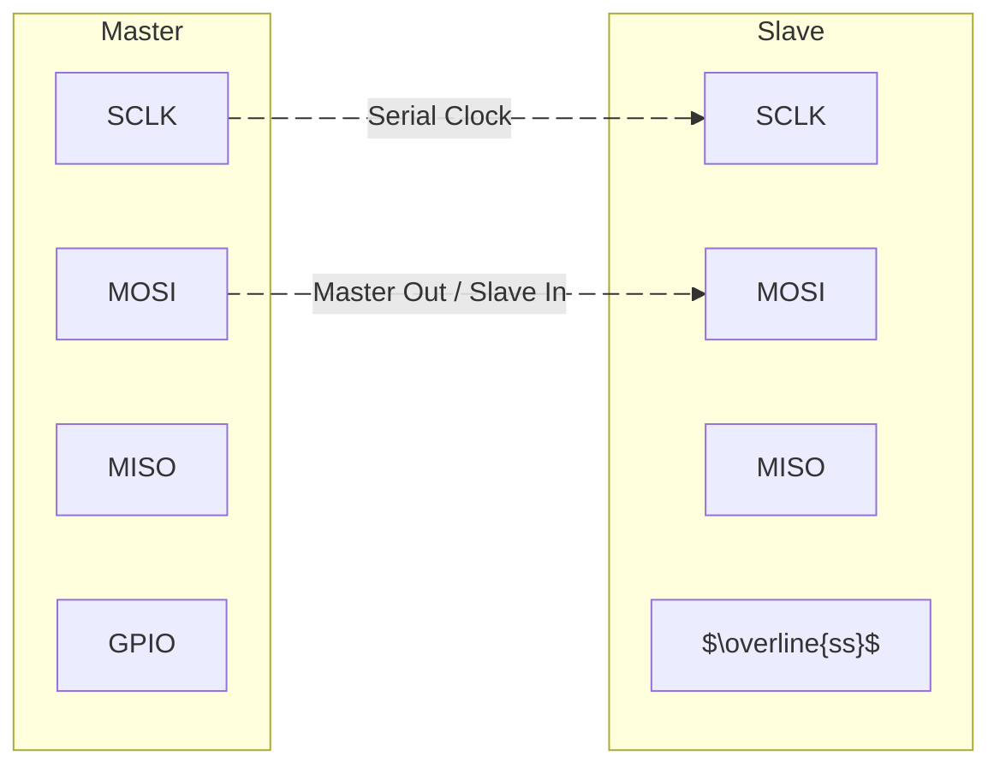
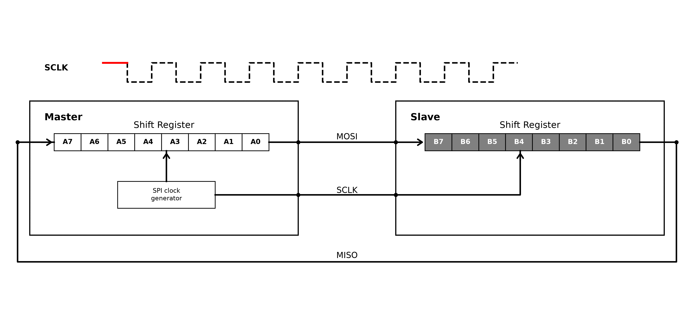

+++
date = '2026-11-07T16:20:23+09:00'
draft = true
title = '07. SPI'
+++

## Introduction to SPI Bus

SPI는 Serial Peripheral Interface의 약자이다. 이는 프로토콜의 한 종류로써, 하나의 Master와 여러개의 Slave가 통신하는데 사용한다.

Slave는 센서나 EEPROM 보드, SD 카드, display 또는 Wi-Fi나 블루투스와 같은 무선 연결 보드가 될 수 있다.

Master에서 Slave로 데이터를 보내거나 받기 위해서는 특정 프로토콜이 정의되어야 하며, SPI 외에도 CAN, I2C, Ethernet, USB, RS232, RS485 등이 있다.

위 그림은 1개의 Master 장비와 1개의 Slave 장비가 SPI로 통신하는 것을 보여주는 그림이다. 참고로 SPI 통신으로 N개의 Slave 장비와 통신이 가능하다.

MOSI와 MISO 핀은 데이터를 교환하는 핀이다. SCLK는 데이터 통신 클럭이며, Master와 Slave 사이의 오가는 모든 데이터는 이 serial 클럭과 동기화된다. 때문에 SPI는 Synchronous serial communication protocal이라고 불리기도 한다. 위 그림과 같이 SCLK는 Master에서만 제어할 수 있으며, Slave에서는 받기만 한다.

1개의 Master와 1개의 Slave가 있다면, NSS($\overline{ss}$)는 필요가 없다. NSS($\overline{ss}$)는 Master가 여러 개의 Slave와 통신할때 사용된다. Master는 통신하고자 하는 slave를 NSS($\overline{ss}$)를 통해 선택할 수 있기 때문에, NSS를 Slave control pin 또는 Slave select pin이라 불린다.

MOSI (Master Out / Slave In) 핀은 Master에서 데이터를 전송하고 Slave에서 데이터를 수신하는 데 사용된다.
MISO(Master In / Slave Out) 핀은 Slave에서 데이터를 전송하고 Master에서 데이터를 수신하는 데 사용된다.

## SPI Comparison with Other Protocols

| Protocol | Type | Max distance (ft.) | Max Speed (bps) | Typical usage |
| - | - | - | - | - |
| USB 3.0 | dual simplex serial | 9 (typical) (up to 49 with 5 hubs) | 5 G | Mass storage, video |
| USB 2.0 | half duplex serial | 16 (98 ft. with 5 hubs) | 1.5M, 12M, 480M | Keyboard, mouse, drive, speakers, printer, camera |
| Ethernet | serial | 1600 | 10G | network communications |
| I2C | synchronous serial | 18 | 3.4 M in High-speed mode. | Microcontroller communications |
| RS-232 | asynchronous serial | 50–100 | 20k | Modem, mouse, instrumentation |
| RS-485 | asynchronous serial | 4000 | 10M | Data acquisition and control systemSPI |
| SPI | synchronous serial | 10 | $\text{f}_{\text{PCLK}}/2$ | |

요구사항에 따라 어떤 Serial 통신 프로토콜 또는 인터페이스를 사용할지 신중히 선택해야 한다.

참고로 SPI와 I2C 같은 통신 프로토콜은 $0 \text{V}$에서 $5 \text{V}$ 전압 범위의 TTL 시그널링을 사용하여 통신하는 반면, CAN이나 RS485 같은 프로토콜은 Differential Signaling($10 \text{V}$ 초과)을 사용하여 통신한다. 이것이 바로 SPI와 I2C가 단거리 통신 인터페이스인 이유이다.

## Importance of SPI Slave Select Pin

Master-Slave 간의 SPI 통신을 하기 위해서는 두 장비 모두 SPI 통신을 지원해야만 한다.

SPI 통신을 할 때, Master는 어떤 Slave를 사용할 것인지 선택해야 한다. 즉 Master는 GPIO 중 하나를 사용하여 Slave의 slave select pin을 ground에 연결한다. 그런 뒤 slave이 slave select pin이 ground로 떨어지면, slave의 SCLK, MOSI, MISO 핀이 활성화된다. 반대로 slave이 slave select pin이 0 또는 ground로 떨어지지 않으면, slave의 MOSI, MISO 핀이 활성화되지 않으면서 High 임피던스(HI-Z) 상태가 된다. 따라서 프로그램으로 slave select pin을 ground로 떨어뜨리도록 제어하여 slave를 선택해야 한다.

### SPI Minimum Bus Configuration

만약 데이터가 Master에서 Slave로만 전송된다고 한다면 어떨까? Slave의 $\overline{SS}$ 핀을 내부적으로 항상 GND로 고성시킨다면, Master와 Slave간에는 오직 2개 라인만 있으면 통신이 가능할 것이다. 즉, 애플리케이션의 요구사항에 따라 SPI 신호 구조를 커스텀할 수 있다는 의미이다. 이처럼 상황과 목적에 따라, SPI 통신을 할 때 항상 4개의 핀이 필요한 것은 아니다.

## SPI Hardware: Behind the Scenes

