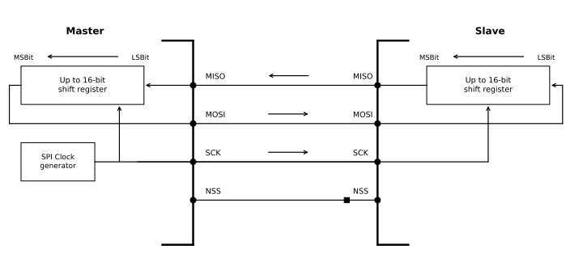
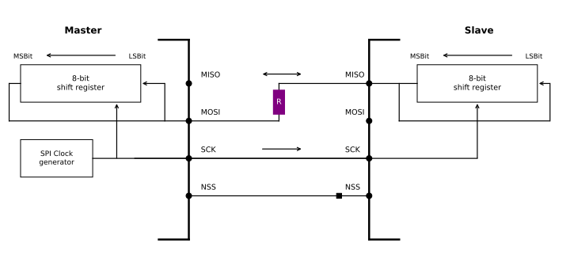
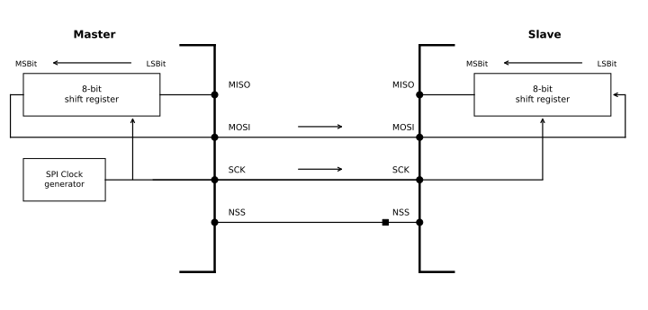
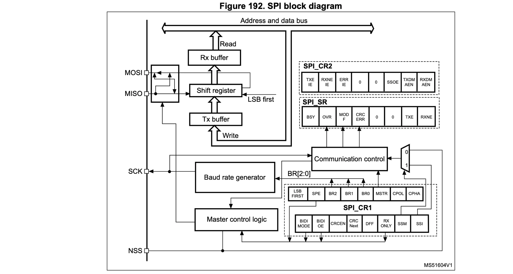
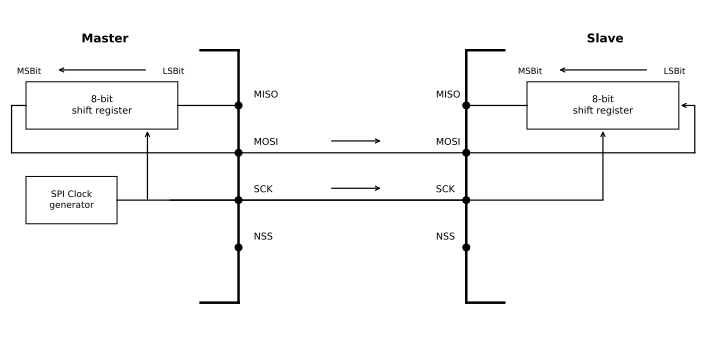
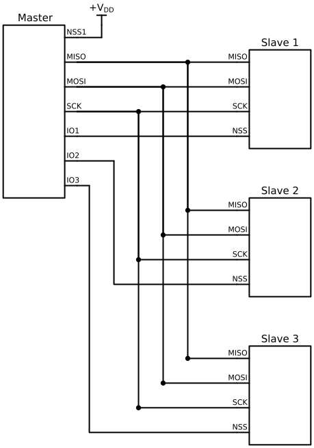

+++
date = '2026-11-07T18:37:33+09:00'
# draft = true
title = '08. SPI Configuration'
+++

## Customizing SPI BUS: BUS Configuration

SPI는 연결 대상 장치와 그 요구사항에 따라 다양한 설정으로 통신할 수 있다.

### Full-Duplex Communication

기본적으로 SPI는 full-duplex 통신으로 설정되어 있어, 데이터를 보내는 동시에 받을 수 있다.

Full-duplex 통신에서 Master와 Slave의 Shift Register는 MISO와 MOSI 핀 사이에 있는 두 개의 단방향 라인을 통해 서로 연결된다. 통신은 SCK 클럭에 동기화된 데이터의 Shift 방식으로 진행된다.

SPI full-duplex 통신이 진행되는 동안 Master는 MOSI 라인을 통해 Slave에게 보낼 데이터를 전송하고, 동시에 MISO 라인을 통해 Slave로부터 데이터를 수신한다.

### Half-Duplex Communication

이 설정에서는 단 하나의 교차 연결 라인을 사용하여 Master와 Slave의 Shift Register를 서로 연결하여 핀을 절약할 수 있다.

데이터는 Master와 Slave가 상호 양방향으로 선택한 전송 방향에 맞춰 SCK 클럭에 동기화되어 Shift 방식으로 이동한다.

레지스터를 설정하여 언제든지 Master가 전송 모드이고 Slave가 수신 모드가 되어 Master에서 Slave로 데이터를 전송하고, Master가 수신 모드이고 Slave가 송신 모드가 되어 Slave에서 Master로 데이터를 전송할 수 있다.

대부분의 MCU SPI 통신을 할 때 half-duplex 통신을 사용할 수 있으나, 일부 MCU에서는 이를 허용하지 않으므로 Reference Manual을 통해 사용 가능한지 확인해야 한다.

### Simplex Communication

이 설정에서는 Master는 송신 전용으로만 / Slave는 수신 전용 모드로만 동작한다.

Master를 송신 모드으로 또는 수신 모드로만 설정할 수 있는데, 이때 사용하지 않는 라인은 제거하여 일반 GPIO 핀으로 사용할 수 있다.

설정 방법은 full-duplex 모드와 동일하지만, 프로그램에서 사용하지 않는 입력 핀의 데이터를 무시해야 해야, 해당 핀을 일반 GPIO 핀으로 사용할 수 있다.

## STM32 SPI Functional Block Diagram

Reference Manual을 보면 SPI 통신에는 4개의 핀(MOSI, MISO, SCK, NSS)을 사용한다.
MOSI, MISO 핀 오른편에 Shift register가 있다. Shift register는 16비트 데이터 통신을 지원하므로 해당 레지스터의 크기는 최대 16비트이다. 해당 MCU가 Master라면 데이터는 Shift register에서 나와 MOSI 핀을 거쳐 외부로 나간다. 해당 MCU가 데이터를 받아야 할때는 외부에서 MISO 핀을 거쳐 Shift register로 이동한다.

Shift register 위에는 Rx buffer가 있고, 아래에는 Tx buffer가 있다. 이 버퍼는 Address and data bus를 통해 접근할 수 있는데, 이 버스는 APB 버스이다.

Shift register에서 데이터를 모두 받으면(1바이트 또는 2바이트) 해당 데이터는 Rx buffer로 이동한다. 이때 우리는 Rx buffer로부터 수신받은 데이터를 읽을 수 있다. 즉, Shift register에 데이터가 모두 차서 Rx Buffer로 데이터를 옮기면 인터럽트를 발생시켜 수신받은 데이터를 읽을 수 있게 한다.

반면, 펌웨어나 코드에서 Tx buffer로 데이터를 쓰다가 Shift register가 비어있으면 (통신 중에 busy하지 않으면) Tx buffer는 즉시 갖고 있는 데이터를 Shift register로 옮기고 전송이 시작된다. 즉, Tx buffer에 데이터를 쓰거나 Tx buffer에서 shift register 데이터를 옮길 때 인터럽트가 발생한다. Tx buffer가 비어있거나 Shift register가 free일 때 인터럽트가 발생시켜 데이터를 쓰거나 옮길 수 있게 한다.

해당 MCU가 Master라면 SCK 핀은 baud rate generator를 통해 제어되며, baud rate는 Control 레지스터를 통해 baud rate 설정할 수 있다.

## Slave Select (NSS) Pin Management

- Slave 모드일 때: NSS 핀은 표준 Chip Select 입력으로 작동하며, Slave가 Master와 통신할 수 있도록 허용한다. 즉, Master가 NSS 핀을 Low로 내려야 Slave가 선택되어 통신이 시작된다.

- Master 모드일 때: NSS 핀은 출력 또는 입력으로 모두 사용할 수 있다. 입력으로 사용할 경우 Multi-master bus의 충돌을 방지할 수 있으며, 출력으로 사용할 경우 단일 Slave의 Slave Select Signal를 제어 할 수 있다.

### Software Slave Management

하드웨어 또는 소프트웨어 슬레이브 선택(NSS) 관리는 SPIx_CR1 레지스터의 SSM(Software Slave Management) 비트를 사용하여 설정할 수 있다.

Software slave management에서는 slave select pin 핀은 사용하지 않으므로 Slave가 Master와 통신을 하려면 어떻게든 NSS는 ground가 되어야 한다.

소프트웨어 NSS 관리 모드(SSM = 1)에서는 Slave Select 정보가 외부 핀이 아닌, SPIx_CR1 레지스터 내부의 SSI 비트 값에 의해 내부적으로 제어된다. 이에 따라 물리적인 외부 NSS 핀은 SPI 통신에 얽매이지 않고 일반 GPIO 핀 등 다른 응용 목적으로 자유롭게 활용할 수 있다.

SSM = 1 상태에서 SSI = 0으로 설정할 경우, Slave의 내부 NSS 신호는 Ground(Low) 상태가 된다. 이로 인해 해당 Slave가 활성화되어 Master와 데이터를 주고받을 수 있는 통신 상태로 전환된다. 반대로 SSM = 1 상태에서 SSI = 1로 설정하면 내부 NSS 신호가 $\text{V}_\text{DD}$(High) 상태가 되어 통신이 비활성화된다.

다만, 이와 같은 software slave management 방식은 핀 하나당 하나의 내부 비트로 제어되는 특성상, 1개의 Master와 1개의 Slave 간 1:1 통신 환경에서만 사용할 수 있습니다.

### Hardware Slave Management

SPI 하드웨어 주변장치가 직접 제어한다. 이 모드에서 Master의 NSS 핀은 출력(Output) 모드로 설정되어야 한다. 이는 핀이 지속적으로 High 상태를 유지한다는 뜻이 아니라, Master가 Slave 제어를 위한 신호(High/Low)를 외부로 직접 내보내는 주체가 됨을 한다.

Slave를 활성화하여 Master와의 데이터 송수신을 가능하게 하려면, Master의 NSS 핀 신호가 접지(Ground) 방향인 Low(로우) 레벨로 제어(Pull-down)되어야 한다. NSS 신호가 Low 상태를 유지하는 동안 해당 Slave는 자신이 선택되었음을 인식하고 Master와 정상적으로 통신을 수행합니다.

위 그림은 1개의 Master가 3개의 Slave를 hardward slave management 방식으로 제어하는 구조이다. 각 Slave의 NSS 핀은 Master의 GPIO와 연결되어 있고, Master의 NSS는 모드 에러(MODF)를 방지하기 위해 $\text{V}_\text{DD}$에 연결하여 High 상태를 유지한다. Master의 NSS 핀을 일반 GPIO로 사용하는 경우에는 $\text{V}_\text{DD}$ 연결이 필요 없지만, GPIO의 alternate function을 통해 NSS 전용 핀으로 사용하는 경우에는 반드시 $\text{V}_\text{DD}$에 연결해야 한다.
