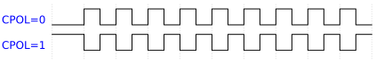
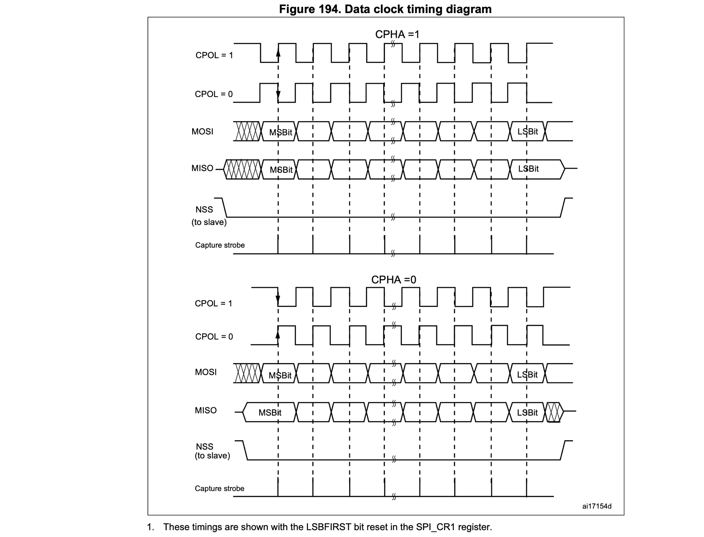
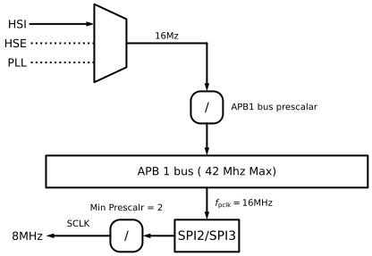
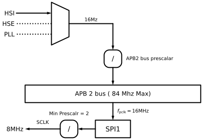

+++
date = '2026-11-08T12:40:56+09:00'
# draft = true
title = '09. SPI Communication Format'
+++

## SPI Communication Format

SPI 통신 포맷에는 3가지가 있다.

- SCLK Phase (SPHA)
- SCLK Polarity (CPOL)
- Data Frame Format (DFF)

SPI 통신은 데이터를 보내는 동시에(Transmit) 받는(Receive) 동작이 동시에 이루어진다. Serial 클럭(SCK) 신호에 맞춰 데이터 라인(MOSI, MISO)의 정보들을 밀어내고(Shifting) 읽어들여(Sampling) 동기화한다.

SPI 통신 포맷은 Clock Phase, Clock Polarity, Data Frame Format에 의해 결정된다. Master와 Slave가 서로 정상적으로 통신하려면 반드시 동일한 통신 포맷으로 설정되어 있어야 한다.

### Data Frame Format (DFF)

SPI Data Frame format는 8bit 또는 16bit로 되어 있다. 기본적으로 8bit data format으로 설정되어 있다.

### Clock Polarity (CPOL)

Clock Polarity(CPOL) 비트는 데이터가 전달되지 않을 때의 클럭 idle state값을 제어한다.

CPOL 비트가 0이면 SCLK 핀의 idle state는 LOW가 되고, CPOL 비트가 1이 되면 SCLK 핀의 idle state는 HIGH가 된다. Idle state란 Master와 Slave간 통신이 없을 때의 상태를 말한다.

CPOL 값에 따른 클럭 형태는 위와 같다.

CPOL이 1로 설정되면 클럭의 idle state가 HIGH로 유지되므로, 클럭이 HIGH에서 LOW로 떨어지는 하강 에지(Falling Edge)부터 LOW에서 HIGH로 올라가는 상승 에지(Rising Edge)에서 1주기가 마무리 된다. CPOL의 기본값은 0이며, 통신 대상 기기의 요구사항에 따라 클럭 형태를 선택해야 한다.

### Clock Phase (CPHA)

Clock Phase(CPHA) 비트는 클럭의 첫 번째 에지와 두 번째 에지 중 언제 Slave가 데이터를 읽어들일지를 제어한다.

CPHA 설정에 따른 데이터 읽기 시점의 특징은 다음과 같다.

- CPHA = 0: 클럭의 첫 번째 에지(Leading edge)에서 데이터 읽기
- CPHA = 1: 클럭의 두 번째 에지(Trailing edge)에서 데이터 읽기

SPI 통신은 CPOL과 CPHA의 조합에 따라 총 4가지 데이터 통신 모드를 지원하므로, 사용하려는 장치의 사양에 맞춰 설정해야 한다.
예를 들어, 통신이 없을 때 클럭의 Idle state를 HIGH로 유지해야 하는 부품이라면 CPOL = 1로 설정해야 한다. 하지만 대부분의 경우 기본값인 CPOL = 0, CPHA = 0 설정을 사용하면 된다.

### Different SPI Modes

| Mode | CPOL | CPHA |
| :-: | :-: | :-: |
| 0 | 0 | 0 |
| 1 | 0 | 1 |
| 2 | 1 | 0 |
| 3 | 1 | 1 |

SPI는 4가지 데이터 통신 모드를 지원한다. 기본 모드는 CPOL=0, CPHA=0이다.

참고로 클럭 주파수가 높을수록 1비트가 유지되는 시간이 매우 짧다. 케이블이 길어지면 신호가 도달하는 데 걸리는 시간(전파 지연)과 전압 감쇠, 노이즈로 인해 파형이 일그러져 데이터 손실(오류)이 발생하기 쉽다. 따라서 고속 통신일수록 케이블을 짧게 유지해야 한다.

반면 클럭 속도를 낮추면(느리게 설정하면) 신호가 전파될 수 있는 시간적 여유가 충분히 확보된다. 선이 길어져 신호가 조금 늦게 도착하더라도 클럭이 여유 있게 기다려주기 때문에, 고속일 때보다 케이블을 더 길게 늘려도 데이터 손실 없이 안정적으로 통신할 수 있다.

## SPI Serial clock (SCLK)

MCU가 지원하는 SPIx 주변장치의 최대 SCLK 속도는 얼마나 될까?

SCLK를 알기 위해서는 먼저 SPI 주변장치가 연결되어 있는 APBx 버스의 속도를 알아야 한다.

위 프로젝트에서는 내부 16MHz HSI 오실레이터를 사용한다. APB1 버스는 SPI2 및 SPI3 주변장치를 포함하며, 현재 APB1 버스 속도는 16MHz(최대 42MHz)이다. 따라서 APB1 버스에 연결된 SPI2와 SPI3의 입력 속도 역시 16MHz를 가진다. SPI 주변장치는 Prescaler를 별도로 가지며 기본값은 2로 설정되어 있다. 결과적으로 SPI의 최종 동작 속도는 8MHz(최대 21MHz)가 된다. 즉, 최종 SPI 속도는 APB1 주변장치의 클럭 속도와 SPI Prescaler 설정값에 의해 결정됩니다.

만약 PLL을 사용하여 APB1 버스를 42MHz로 구동한다면, SPI2와 SPI3는 21MHz의 시리얼 클럭(SCLK)을 생성할 수 있다. 이는 SPI 주변장치의 최대 데이터 전송 속도가 초당 2,100만 비트(21 Mbps)에 달함을 의미하며, 이는 I2C나 CAN 주변장치와 비교할 때 매우 빠른 속도이다.

그럼 APB2 버스에 연결된 SPI1 주변장치를 살펴보자. APB2 버스의 최대 속도는 84MHz이므로, SPI1의 최대 속도는 42MHz까지 가능하다.
하지만 위 프로젝트에서는 HSI를 사용하므로 APB2 버스는 16MHz로 동작하며, 이에 따라 SPI1은 8MHz의 클럭을 생성합니다.
정리하자면, 16MHz의 내부 RC oscillator(HSI)를 시스템 클럭으로 사용하는 환경에서는 SPI1, SPI2, SPI3 주변장치 모두 최대 8MHz의 시리얼 클럭(SCLK)을 생성하게 된다.
